# Batch update through export and import

Technical design · adapted for Campus Commander · 2026-10-26

Status: proposed. The owner decisions in [section 21](#21-owner-decisions-and-engineering-defaults) come before the workflow record and the mockup.
Scope: export ChromeOS devices, edit the file in a spreadsheet, import it, review the changes, confirm, and inspect results.
Source: the owner's technical design of his earlier implementation of this feature, supplied on 2026-10-26.
Baseline: repository `origin/main` at `89d5478`.
Workflow gap: [G16](../workflow-gaps.md). On confirmation, this design replaces the stored-baseline comparison. [Section 22](#22-records-to-update-and-next-steps) lists the affected records.

Reading guide:

- [Purpose and authority](#1-purpose-and-authority)
- [Scope](#2-outcome-and-scope) and [vocabulary](#3-vocabulary)
- [User workflow](#4-user-workflow) and [architecture](#5-architecture-and-reuse)
- [Export](#6-export) and [edit template](#7-edit-template)
- [Row checksum](#8-row-checksum) and [parsing](#9-source-parsing)
- [Validation](#10-validation-job), [review](#11-report-and-review), and [confirmation](#12-confirmation-and-plan)
- [Execution](#13-execution) and [jobs](#14-jobs-states-and-cancellation)
- [API and data](#15-api-and-stored-data), [Google Drive](#16-google-drive-integration), and [authorization](#17-authorization-and-data-handling)
- [Failures](#18-failure-behavior), [examples](#19-worked-examples), and [acceptance checks](#20-acceptance-checks)
- [Owner decisions](#21-owner-decisions-and-engineering-defaults) and [next steps](#22-records-to-update-and-next-steps)
- [Differences from the reference design](#appendix-a-differences-from-the-reference-design) and [sources](#appendix-b-sources)

## 1. Purpose and authority

This document adapts the owner's reference design to Campus Commander.
It keeps the reference behavior where Campus Commander has no conflicting rule.
It maps each responsibility to an existing component where one exists.
It names the decisions that the owner settles before the workflow record.

### Owner direction

| Date       | Direction                                                                                                                                                                                                                                                                             | Source                                                     |
| ---------- | ------------------------------------------------------------------------------------------------------------------------------------------------------------------------------------------------------------------------------------------------------------------------------------- | ---------------------------------------------------------- |
| 2026-09-03 | "We need a unique export and import pair (distinct from the existing one-way export and the CSV import)." "Export creates a CSV or Google Sheet." "Re-import runs: validation → preview → confirm → create job." The entry point "lives nested under the bulk actions dropdown menu." | `docs/archive/ux/feature-review-notes-2026-09-03.md:37-42` |
| 2026-10-21 | "As well as import and export for bulk edit."                                                                                                                                                                                                                                         | `docs/workflows/update-device-fields.md:84`                |
| 2026-10-24 | "For google drive we will use the google drive picker." The owner adds the `drive.file` scope to the DWD install scopes.                                                                                                                                                              | Main chat                                                  |
| 2026-10-26 | "My application does NOT need to be backward compatible with this file. I will have my OWN checksum feature."                                                                                                                                                                         | Reference design, section 1                                |
| 2026-10-26 | Adapt the reference design as much as possible. Campus Commander design and code contain no name from the reference product.                                                                                                                                                          | Main chat, paraphrased                                     |

The last row is a paraphrase. The original message names the reference product, so this record does not quote it.

### Labels

| Label               | Meaning                                                                                  |
| ------------------- | ---------------------------------------------------------------------------------------- |
| Reference           | The reference design describes this behavior. Campus Commander keeps its purpose.        |
| Adapted             | Campus Commander changes the reference behavior to fit an existing component or rule.    |
| Owner decision      | A choice that changes visible behavior. Section 21 holds it.                             |
| Engineering default | A choice that the implementation owns. Section 21 lists it, and the owner can change it. |

This document holds no reference implementation code and no reference product names.
It authorizes no build. Live Google writes stay outside the standing test authorization.

## 2. Outcome and scope

A person exports a set of devices to a CSV file or a Google Sheet.
The person edits supported values in Excel or Google Sheets.
Campus Commander finds the edited rows, validates them, and shows each proposed change.
An explicit confirmation starts the existing device update job.
The job page shows the actual outcomes and the read-back values.

### Included

| Capability                                                                       | Slice       | Source                          |
| -------------------------------------------------------------------------------- | ----------- | ------------------------------- |
| Edit export to a CSV file                                                        | First       | Reference, owner 2026-09-03     |
| Import of an uploaded CSV file: validation job, review, confirmation, update job | First       | Reference                       |
| Row checksum, blank cells that keep values, and an explicit clear token          | First       | Reference, owner 2026-10-26     |
| Asset tag, Annotated location, Annotated user, Notes, and Organization unit      | First       | Reference, field rules as built |
| Edit export to a Google Sheet in the person's own Drive                          | Second      | Owner 2026-10-24                |
| Import from Google Drive through the Google Picker: a Sheet tab or a CSV file    | Second      | Owner 2026-10-24                |
| `drive.file` in the DWD scope list, setup inputs, and the Diagnostics check      | Second      | Owner 2026-10-24                |
| Report export: visible grid columns, no row checksum, CSV file or Google Sheet   | Third       | Reference, owner 2026-09-03     |
| Status actions in the file: Disable, Re-enable, Deprovision                      | Decision D3 | Reference                       |

### Excluded

- Device creation, enrollment, or deletion. An unknown device ID never creates a device.
- Device commands: Reboot, Wipe user data, and Powerwash.
- Google users, groups, and organizational units. Later phases reuse this design.
- Execution right after upload. Validation never writes to Google.
- A spreadsheet editor inside Campus Commander.
- Automatic rollback of completed Google writes.
- Files from the reference product. Campus Commander owns its headers, checksum, and status syntax.
- Export sharing with recipients and notification email. A Drive owner shares a Sheet in Drive.
- A report of the devices that a bulk action skipped.
- A new navigation destination. The review uses the page of the validation job.
- Migration, backup, restore, or preservation of development data.

## 3. Vocabulary

| Term                 | Meaning                                                                                                   |
| -------------------- | --------------------------------------------------------------------------------------------------------- |
| Edit export          | An export for editing. It writes the fixed edit template. The purpose label reads "For editing".          |
| Report export        | An export for reading. It writes the visible grid columns and no row checksum. The label reads "Report".  |
| Export job           | The background job that writes an export. Job ID prefix `EXP`.                                            |
| Source               | The CSV file or the Google Sheet tab that a person submits for import.                                    |
| Validation job       | The background job that reads a source and builds the report and the plan. Job ID prefix `IMP`.           |
| Update job           | The existing job `UPD` with action `update-device-annotations`. It executes a confirmed plan.             |
| Device ID            | Google's `deviceId`. It is the inventory key and the target of every write.                               |
| Context column       | A read-only column that helps a person recognize a device.                                                |
| Editable column      | One of the five writable fields.                                                                          |
| Row checksum         | The fingerprint of one row's device ID and editable values at export.                                     |
| Unchanged row        | A row whose file values still match its row checksum.                                                     |
| Candidate row        | A row whose file values differ from its row checksum, or whose checksum cell is blank or malformed.       |
| Changed since export | A candidate row whose current values no longer match its row checksum. Decision D1 defines its treatment. |
| Proposed change      | One validated field value that differs from the current value.                                            |
| Rejected row         | A row that fails a structure, identity, access, or field rule.                                            |
| Report               | The counts, rejected rows, and proposed changes of one validation job.                                    |
| Plan                 | The server-owned list of proposed changes that the review shows.                                          |
| Clear token          | The cell text `[clear]`. It requests an empty field value.                                                |
| Source row number    | The spreadsheet row number of one logical record. The header is row 1.                                    |

The device ID serves as both the device identity and the provider identity of the reference design.
Campus Commander never guesses a device from a serial number, an Asset tag, or a row position.

## 4. User workflow

### 4.1 Export for editing

1. In the Devices grid, select devices. "Select all matching" selects every device that matches the filters.
2. Open Bulk Actions and choose Export.
3. The export sheet shows the scope and the device count.
4. Choose the purpose "For editing" and the format: CSV file or Google Sheet.
5. Create the export job. The sheet shows the receipt and a link to the job.
6. When the job completes, download the CSV file or open the Google Sheet.

The edit template ignores the grid's hidden columns and column order.
An edit export above 50,000 devices stops before the job starts. The sheet names the limit.

### 4.2 Edit

1. Open the file in Excel or the Sheet in Google Sheets.
2. Change supported values. Keep the Device ID and Checksum columns.
3. Leave a cell blank to keep the current value. Type `[clear]` to empty a text field.
4. Save the file as CSV, or keep the Sheet in Drive.

### 4.3 Import and validate

1. Open Bulk Actions and choose Import. Import needs no selection.
2. The import sheet states three rules: blank keeps, `[clear]` empties, and import never creates devices.
3. Choose the source: upload a CSV file, or choose a file from Google Drive.
4. For a Google Sheet, choose the tab. The first tab starts selected.
5. Start validation. The sheet shows the receipt of the validation job.
6. Open the validation job when it completes.

The import sheet links to the edit export, so a person without a file can get one.
Validation reads Campus Commander data and Google device data. It never writes to Google.

### 4.4 Review, confirm, and inspect results

1. The validation job page shows the counts, the rejected rows, and every proposed change.
2. Download the rejected rows to correct them.
3. Decide the rows that changed since export (decision D1).
4. Choose Continue to confirmation. Campus Commander freezes a preview from the plan.
5. Confirm the frozen preview. Campus Commander creates one update job.
6. The update job page shows each operation outcome and the read-back values.

Confirmation identifies the plan by its ID and revision. The browser never sends replacement changes.
Closing the review starts nothing. The plan stays available until it expires.

## 5. Architecture and reuse

| Responsibility           | Campus Commander component                                                                                                                         | State                               |
| ------------------------ | -------------------------------------------------------------------------------------------------------------------------------------------------- | ----------------------------------- |
| Entry points             | Bulk Actions menu, `frontend/src/app/devices/devices.html:196-222`                                                                                 | Adds Export and Import              |
| Export and import sheets | Bulk action sheet, `docs/ui/patterns.md:76-82`                                                                                                     | New content in the existing pattern |
| Export scope             | Server-side selection. It expires 12 hours after its last change, `api/src/app/devices/device-selection.ts:13`.                                    | Reused                              |
| Jobs                     | `cc.jobs`, the Jobs page, and job details, `libs/application-contracts/src/lib/jobs.ts`                                                            | Adds prefixes `EXP` and `IMP`       |
| Files                    | Artifact store: stage, publish, read, and remove, `api/src/app/storage/storage.service.ts:24-33`                                                   | Reused                              |
| Upload                   | No upload route exists. The edge buffers request bodies and caps them, `deployment/bootstrap/application-edge.mjs:184-201`.                        | New streaming route                 |
| Current values           | Entity cache. A device counts as fresh for 24 hours, `libs/application-contracts/src/lib/entity-cache.ts:17`.                                      | Reused                              |
| Field rules              | `DEVICE_UPDATE_FIELD_LIMITS` and `deviceUpdateChangeSchema`, `libs/application-contracts/src/lib/devices.ts:437-538`                               | Reused                              |
| Preview                  | Edit-list preview with a baseline per edit, `api/src/app/devices/device-updates.ts:216-284`                                                        | Reused at confirmation              |
| Execution                | Update job `UPD` with read-back and cache update. Confirmation is idempotent, `docs/superpowers/specs/2026-10-16-device-write-jobs-design.md:578`. | Reused                              |
| Google access            | DWD capability list, `libs/application-contracts/src/lib/google-capabilities.ts`                                                                   | Adds `drive.file`                   |
| Drive files              | Google Picker in the browser. Sheets and Drive APIs in the worker.                                                                                 | New                                 |

The reference design reuses its ordinary batch update executor for import execution.
Campus Commander does the same. The import adds no second write engine.

Legend: green is reused as built, blue is new, amber is an owner decision, and gray is a later slice.

```mermaid
flowchart TD
  classDef reuse fill:#d3f9d8,stroke:#2f9e44,color:#1e1e1e
  classDef new fill:#d0ebff,stroke:#1c7ed6,color:#1e1e1e
  classDef decision fill:#fff3bf,stroke:#f08c00,stroke-dasharray:6 3,color:#1e1e1e
  classDef later fill:#f1f3f5,stroke:#868e96,stroke-dasharray:6 3,color:#495057

  B["Devices grid · Bulk Actions<br/>new entries: Export and Import"]:::new

  subgraph EX["1 · Export · export job EXP"]
    E1["Export sheet<br/>purpose: for editing or report<br/>format: CSV or Google Sheet<br/>scope: the selection · at most 50,000 for editing"]:::new
    E2["Freeze the device IDs<br/>expired selection: refuse, never widen"]:::reuse
    E3["Write the edit template<br/>Device ID, context, five fields, row checksum"]:::new
    E4{"Format"}:::new
    E5["CSV file in the artifact store<br/>authorized download · 30 days"]:::reuse
    E6["Google Sheet in the person's own Drive<br/>RAW text values · drive.file"]:::new
    E1 --> E2 --> E3 --> E4
    E4 -->|"CSV"| E5
    E4 -->|"Google Sheet"| E6
  end

  O1["Edit in Excel or Google Sheets<br/>blank keeps the value · [clear] empties it"]:::new

  subgraph IM["2 · Import · validation job IMP"]
    I1{"Source"}:::new
    I2["Upload a CSV file<br/>streaming route with its own cap"]:::new
    I3["Choose from Google Drive<br/>Picker: a Sheet tab or a CSV file"]:::new
    I4["Parse and check structure<br/>headers by name, limits, one stored snapshot"]:::new
    I5{"File values match<br/>the row checksum?"}:::new
    I6["Unchanged row<br/>no read, no write"]:::new
    I7["Candidate row<br/>device ID, access, and field rules<br/>one invalid field rejects the row"]:::reuse
    I8{"Current values match<br/>the row checksum?"}:::decision
    I9["Changed since export<br/>keep current by default · D1"]:::decision
    I10["Compare with current values<br/>no change needed, or a proposed change"]:::new
    I1 -->|"CSV file"| I2 --> I4
    I1 -->|"Google Drive"| I3 --> I4
    I4 --> I5
    I5 -->|"yes"| I6
    I5 -->|"no"| I7 --> I8
    I8 -->|"no"| I9 --> I10
    I8 -->|"yes"| I10
  end

  subgraph RV["3 · Review on the validation job page"]
    R1["Counts that add up<br/>rejected rows with reasons and a download<br/>every proposed change: current to new"]:::new
    R2["Rejected rows: correct the file,<br/>or run the valid rows · D2"]:::decision
    R3["Freeze an edit-list preview<br/>a changed current value returns to review"]:::reuse
    R4["Confirm<br/>a second click returns the same job"]:::reuse
    R1 --> R2 --> R3 --> R4
  end

  subgraph JB["4 · Update job UPD"]
    J1["Existing executor<br/>one PATCH per device, read-back, cache update"]:::reuse
    J2["Results on the job page<br/>succeeded, failed, unknown, skipped"]:::reuse
    J3["Status actions as status jobs STS<br/>later slice · D3"]:::later
    J1 --> J2
  end

  B -->|"Export"| E1
  E5 --> O1
  E6 --> O1
  O1 -->|"Import"| I1
  I6 --> R1
  I10 --> R1
  R4 --> J1
  R4 -.-> J3
```



## 6. Export

### 6.1 Two purposes

| Concern      | Edit export                        | Report export                               |
| ------------ | ---------------------------------- | ------------------------------------------- |
| Intent       | Change device values               | Read or share inventory data                |
| Columns      | The fixed edit template, section 7 | The visible grid columns, in grid order     |
| Device ID    | Required                           | Present when the grid shows it              |
| Row checksum | Included                           | Omitted                                     |
| Status       | Current status as a context column | Current status as the grid displays it      |
| Import       | Supported                          | Refused. The message names the edit export. |
| Limit        | 50,000 devices                     | The authorized scope                        |

### 6.2 Scope

- The request carries the tab's selection key, as the update preview request does.
- The API binds the selection to the signed-in person and the customer.
- An expired selection refuses the export. The export never widens to all devices.
- The job freezes the device IDs at start and records the filters, sort, and count.
- The job applies the access checks of the device read routes to the frozen scope.
- An empty scope writes the header row and no device rows.
- Rows follow the grid sort. The device ID breaks ties.

### 6.3 Writing

- The job reads devices from the inventory in bounded batches.
- It writes batches in batch order, not in completion order.
- It formats each editable value by the import rules and computes the row checksum from those values.
- A failed batch fails the job. The job never publishes a partial file as complete.
- The job records the format, the row count, the artifact or spreadsheet ID, and the completion time.

### 6.4 CSV file

- UTF-8 with a byte order mark, a comma separator, CRLF record ends, and RFC 4180 quoting.
- Quoted cells keep commas, quotes, and line feeds.
- The writer streams into the artifact store. Memory stays bounded.
- A cell that starts with `=`, `+`, `-`, `@`, a tab, or CR gets a leading tab. Import removes exactly that tab.
- The row checksum covers the value without the added tab.
- The download uses an authorized short-lived link. The file expires after 30 days.

### 6.5 Google Sheet

- The worker creates the spreadsheet in the signed-in person's own Drive, as that person (section 16).
- It writes values with the value input option `RAW`. Google stores text and evaluates no formula.
- It sets the text number format on every template column, so typed values keep leading zeros.
- It freezes the header row. Column widths and header style are optional.
- The person owns the spreadsheet. Campus Commander keeps its ID and link, not a copy.
- The export sheet disables Google Sheet with a note when Drive is not available to the person.

## 7. Edit template

### 7.1 Columns

| Header             | Role                       | In the checksum | Rule                                                           |
| ------------------ | -------------------------- | --------------- | -------------------------------------------------------------- |
| Device ID          | Identity, required         | Yes             | Google's `deviceId`. Never a write.                            |
| Serial number      | Context                    | No              | Read-only.                                                     |
| Model              | Context                    | No              | Read-only.                                                     |
| Status             | Context                    | No              | Read-only in the first slice. Decision D3 adds status actions. |
| Asset tag          | Editable                   | Yes             | `annotatedAssetId`. 1 to 256 code points. Replace only.        |
| Annotated location | Editable                   | Yes             | 1 to 200 code points, or clear.                                |
| Annotated user     | Editable                   | Yes             | 1 to 100 code points, or clear.                                |
| Notes              | Editable                   | Yes             | 1 to 500 code points, or clear. Line feeds are allowed.        |
| Organization unit  | Editable                   | Yes             | An existing path, compared without case. Move only.            |
| Checksum           | Change detection, required | No              | The row checksum, section 8.                                   |

Limits and labels come from `DEVICE_UPDATE_FIELD_LIMITS` and `DEVICE_UPDATE_FIELD_LABELS`.
The importer calls `deviceUpdateChangeSchema`. It keeps no second copy of the field rules.

### 7.2 Schema rules

- One schema module defines the headers, the roles, the field rules, and the checksum fields.
- The import instructions come from the same module.
- Import matches columns by header name, in any order.
- Every template column is required. A missing column refuses the file and names the column.
- A duplicate header refuses the file.
- An unknown column stays out of every write. The report lists it as a warning.
- A misspelled editable header refuses the file, because its template column is missing.

### 7.3 Cell intent

| Cell                                                    | Intent | Effect                                                      |
| ------------------------------------------------------- | ------ | ----------------------------------------------------------- |
| Empty, or spaces only                                   | Keep   | No change to the field.                                     |
| `[clear]` in any letter case, with outer spaces ignored | Clear  | Writes an empty value where the field allows it.            |
| Any other value                                         | Assign | Validates the value and compares it with the current value. |

The clear token is reserved. A person cannot set the literal text `[clear]` as a field value.

### 7.4 Field rules

| Field              | Assign                   | Clear                                       | The review shows                                               |
| ------------------ | ------------------------ | ------------------------------------------- | -------------------------------------------------------------- |
| Asset tag          | Replace                  | Rejects the row. Google keeps no empty tag. | Current and new tag. A duplicate tag warns and does not block. |
| Annotated location | Replace                  | Empty value                                 | Current and new value.                                         |
| Annotated user     | Replace                  | Empty value                                 | Text only. It grants no access and creates no account.         |
| Notes              | Replace                  | Empty value                                 | Line feeds. CRLF compares equal to LF.                         |
| Organization unit  | Move to an existing unit | Rejects the row. Every device has a unit.   | Current and new path.                                          |

A text value needs a visible character. The import keeps its spaces, as the field rules as built require.

## 8. Row checksum

### 8.1 Mechanism

The checksum is Campus Commander's own, as the owner directed on 2026-10-26. Its mechanism is an engineering default.

- Input: a JSON array of the schema version, the device ID, and the five canonical editable values in template order.
- Digest: SHA-256 of the UTF-8 bytes of that array.
- Cell value: the schema version, a dot, and the first 16 digest bytes as 22 base64url characters.
- The JSON array separates the fields, so two different field sequences never share one input.
- The digest needs no key. It detects edits. It proves no identity, permission, or file origin.

### 8.2 Canonical values

| Concern           | Rule                                                          |
| ----------------- | ------------------------------------------------------------- |
| Blank             | Null, empty text, and spaces only become empty text.          |
| Line ends         | CRLF and CR become LF.                                        |
| Unicode           | NFC normalization, for the checksum and for every comparison. |
| Organization unit | Lower case, for the checksum and for every comparison.        |
| Formula escape    | Import removes the export tab before the checksum.            |
| Spaces in a value | Kept. A text value is never trimmed.                          |
| Clear token       | Hashes as the token text. A clear differs from a blank.       |

Export, import, and the current-value check call one function.
Its tests cover multiline notes, quotes, commas, Unicode, leading zeros, and the clear token.

### 8.3 Partition

| Condition                        | Treatment                                                       |
| -------------------------------- | --------------------------------------------------------------- |
| Checksum matches the file values | Unchanged row. No inventory read and no write.                  |
| Checksum differs                 | Candidate row with full validation. A mismatch is not an error. |
| Checksum cell blank              | Candidate row with full validation.                             |
| Checksum cell malformed          | Candidate row. The report notes the malformed cell.             |
| Checksum column missing          | The file is refused before row checks.                          |

An unchanged row never restores an old value, even when the device changed after the export.
Duplicate device IDs count across all rows, unchanged rows included (section 10.2).

### 8.4 Rows that changed since export (decision D1)

A row checksum cannot tell which fields the person edited.
A candidate row therefore compares every nonblank file value with the current value.
When another person changed a field after the export, the file value restores the old value.

Example: the export holds Asset tag "A". Another administrator sets "B". The person edits only Notes.
The review proposes "B → A" for Asset tag and the Notes change.

Decision D1 chooses the treatment:

| Option                               | Behavior                                                                                                                                                                                                                                             | Cost                                                              |
| ------------------------------------ | ---------------------------------------------------------------------------------------------------------------------------------------------------------------------------------------------------------------------------------------------------- | ----------------------------------------------------------------- |
| A. Reference                         | The review shows every write. Nothing flags the row.                                                                                                                                                                                                 | A stale row restores old values without a warning.                |
| B. Current-value check (recommended) | Validation computes the checksum of the current values. A difference from the file's checksum marks the row Changed since export. Keep current is the default for marked rows. The person keeps the file values for one row or for every marked row. | No stored data. A changed device ID also marks its row.           |
| C. Stored baselines                  | The export stores every exported value. Import compares the baseline, file, and current value of each field, as the earlier records require.                                                                                                         | Baseline storage, baseline expiry, and per-field conflict review. |

Option B matches the conflict rule of in-grid editing: keep the current value or keep the draft (`docs/current-work.md:81`).
Option B treats a blank or malformed checksum cell as Changed since export. That choice gives a deliberate full import.

## 9. Source parsing

### 9.1 Common output

Both source types produce the same output:

- The source type, the display name, and the Drive file ID and tab ID where they apply.
- The header mapping and its warnings.
- Logical rows with source row numbers.
- The original text of each cell and its canonical value.
- File errors that stop validation.

The parser produces data. It never produces a write.

### 9.2 CSV file

| Concern                | Rule                                                                           |
| ---------------------- | ------------------------------------------------------------------------------ |
| Encoding               | UTF-8, with or without a byte order mark. Another encoding refuses the file.   |
| Separator              | Comma only.                                                                    |
| Quoting                | RFC 4180. Quoted cells hold commas, quotes, and line feeds.                    |
| Record ends            | LF or CRLF.                                                                    |
| Header                 | The first record.                                                              |
| Ragged record          | Refuses the file. A value never shifts into another column.                    |
| Trailing empty records | Ignored.                                                                       |
| No data rows           | The report shows zero rows and no plan.                                        |
| Limits                 | 50,000 data rows, a byte limit, and a cell limit. The refusal names the limit. |

The byte limit stays above the largest edit export of 50,000 devices. Engineering sets it from the field limits.
The upload streams into the artifact store before parsing. The stored source stays unchanged.

### 9.3 Google Drive file

- The Picker shows the Google Sheets and CSV files in the person's Drive.
- A Google Sheet needs a tab. The API lists tabs with `spreadsheets.get`, as the person.
- The worker reads the whole tab with `spreadsheets.values.get` and formatted values.
- The Sheets API reads the tab because the Drive export method caps exported content at 10 MB.
- Hidden and filtered rows count as rows. The import sheet states that rule.
- A CSV file in Drive downloads with `files.get` and goes through the CSV parser.
- The worker stores the values that it read as the validation input. Later Drive edits change nothing.
- A missing file, a lost grant, or a refused read stops validation with a source error.

## 10. Validation job

### 10.1 Order

1. Establish the person, the customer, and the person's permissions from the session.
2. Read the source. Check its structure and limits.
3. Map the headers to the schema.
4. Find duplicate device IDs across all rows.
5. Partition the rows by row checksum.
6. Resolve each candidate device ID in the customer's inventory.
7. Refresh candidate devices older than 24 hours through the existing refresh path.
8. Read current values and observation times for candidate devices.
9. Apply the access checks of the edit-list preview to each target device.
10. Interpret keep, clear, and assign for each editable cell.
11. Validate each assigned value with the shared field rules. One invalid field rejects the row.
12. Mark rows that changed since export (decision D1).
13. Compare each requested value with the current value. Drop equal values.
14. Store the report and the plan as artifacts.
15. Complete the job. The validation job page opens the review.

### 10.2 Identity

- Every occurrence of a duplicated device ID rejects its row.
- An unknown or removed device ID rejects its row. Import never creates a device.
- An edited device ID targets the device that it names. Validation and review still apply to it.
- The review shows the inventory serial number and model of each target, not the file's context cells.

### 10.3 Current values

- Validation compares with the entity cache after the refresh in step 7.
- The report records the oldest observation time and shows the stale warning of the update preview.
- A failed read blocks the review. An unknown value never counts as an empty value.
- Per-device resource scope arrives with the platform-access workflow. Validation applies the checks that exist then.

### 10.4 Row results

| Result               | Meaning                                                          |
| -------------------- | ---------------------------------------------------------------- |
| Unchanged            | The row checksum matches the file values.                        |
| No change needed     | A candidate row whose requested values equal the current values. |
| Proposed             | A candidate row with at least one proposed change.               |
| Changed since export | A proposed row that decision D1 holds for a person's choice.     |
| Rejected             | A row that fails a rule. The row keeps every reason.             |

A clear on an empty field needs no change.
In the first slice, an edited Status cell changes nothing. The Status column stays context.

## 11. Report and review

### 11.1 Content

| Area             | Content                                                                              |
| ---------------- | ------------------------------------------------------------------------------------ |
| Identity         | Validation job ID, person, source name, source type, and tab                         |
| Time             | Submission, completion, and the oldest observation time                              |
| Counts           | Rows, unchanged, no change needed, proposed, changed since export, rejected          |
| Rejected rows    | Source row number, device context, field, submitted value, and reason                |
| Proposed changes | Device, field, current value, and new value. A clear shows as an explicit operation. |
| Scope            | The devices and field changes that confirmation submits                              |
| Plan             | Plan ID and revision                                                                 |

### 11.2 Counts

For a completed validation job:

```text
rows = unchanged + no change needed + proposed + rejected
```

Changed since export is a subset of proposed.
A rejected row counts once. It can carry several reasons.
Rows, devices, field changes, and operations keep separate labels.
A blocked validation shows its unevaluated rows separately and states that the report is incomplete.

### 11.3 Review page

- The review uses the page of the validation job. It follows the job details pattern, `docs/ui/patterns.md:299`.
- A grid lists proposed changes, rejected rows, and changed rows, with filters and pages.
- The browser loads one page at a time. It never loads the complete report.
- The rejected rows download as a CSV file with source row numbers and reasons.
- A report with no proposed rows and no rejected rows states that no update is needed.
- Figma draws the CSV steps as full pages. The mockup settles the composition.

### 11.4 Rejected rows (decision D2)

| Option                           | Behavior                                                                                  |
| -------------------------------- | ----------------------------------------------------------------------------------------- |
| A. Correct the file              | One rejected row disables confirmation. The person corrects the file and validates again. |
| B. Explicit subset (recommended) | Confirmation names the accepted rows and the excluded count. Only accepted rows run.      |

Until the owner decides, the build disables confirmation when a rejected row exists.

## 12. Confirmation and plan

- The plan holds each target device ID, each requested value, and the current value that the review showed.
- Continue to confirmation turns the plan into an edit-list preview through the existing preview builder.
- Each edit carries its reviewed current value as its baseline.
- A current value that changed after the review makes its row a conflict. Conflicts return to the review.
- The preview expires after 15 minutes, as the update preview does, `api/src/app/devices/device-updates.ts:48`.
- The plan stays confirmable for 24 hours after validation (engineering default).
- Confirmation rechecks permissions and creates one update job. A repeated click returns the same job.
- A confirmed plan never runs again. Later edits to the source need a new validation job.

The edit-list route accepts at most 500 devices and 2,500 edits.
The validation job calls the preview builder directly, under the 100,000-target cap, `api/src/app/devices/device-updates.ts:50`.

## 13. Execution

- The update job runs the frozen preview with the existing executor.
- Each device gets one PATCH with every changed field, then a read-back.
- The job stores the observed values in the inventory and updates the cache.
- The job page shows the succeeded, failed, unknown, and skipped outcomes, as built.
- A read-back failure after a successful write keeps the write outcome.
- The grid updates each device when its read-back arrives. A partial job updates its successful devices.
- The update job records the validation job ID. Each job page links to the other.
- Status actions, when decision D3 adds them, run as status jobs `STS` linked to the same validation job.

## 14. Jobs, states, and cancellation

| Job        | Prefix | Action                      | Completion                       |
| ---------- | ------ | --------------------------- | -------------------------------- |
| Export     | `EXP`  | `export-devices`            | File or spreadsheet ready        |
| Validation | `IMP`  | `validate-device-import`    | Report and plan ready, or failed |
| Update     | `UPD`  | `update-device-annotations` | The outcomes as built            |

- The validation job completes when the report is ready. Review is not a running state.
- `EXP` and `IMP` progress counts rows. `UPD` progress counts operations, as built.
- Cancel pending work stops a queued export or validation job. A cancelled validation job keeps no plan.
- Cancellation of an update job keeps completed and in-flight outcomes. It undoes nothing.
- Job state lives in the database. Server events report progress. A reconnect reloads the state.

## 15. API and stored data

### 15.1 Routes

Route names are engineering defaults. The contracts define the information and the trust boundary.

| Route                                       | Person supplies                            | Server supplies                                              |
| ------------------------------------------- | ------------------------------------------ | ------------------------------------------------------------ |
| `POST /api/devices/exports`                 | Purpose, format, selection key, file name  | Receipt of an export job                                     |
| `GET /api/devices/exports/{jobId}/file`     | Job ID                                     | A short-lived download link, or the spreadsheet link         |
| `POST /api/devices/imports`                 | A streamed CSV file                        | Receipt of a validation job                                  |
| `POST /api/devices/imports/drive`           | Drive file ID, tab ID                      | Receipt of a validation job                                  |
| `GET /api/devices/imports/{jobId}/report`   | Page, filter                               | Counts, rows, plan ID, and revision                          |
| `GET /api/devices/imports/{jobId}/rejected` | Job ID                                     | CSV file of the rejected rows                                |
| `POST /api/devices/imports/{jobId}/preview` | Plan ID, revision, choices for marked rows | A frozen preview, or the conflicts                           |
| The existing update confirm route           | Preview ID                                 | Receipt of an update job                                     |
| `POST /api/google/drive/session`            | Nothing                                    | A one-hour token, the API key, and the App ID for the person |
| `GET /api/google/drive/files/{fileId}/tabs` | Drive file ID                              | Tab IDs and titles                                           |

- Errors use the existing reason style. They separate an invalid source, denied access, an unknown job, an expired plan, and unavailable storage.
- The person never supplies a storage path, a DWD subject, a credential, or a customer ID.

### 15.2 Stored data

| Data                                                   | Storage                 | Retention                                      |
| ------------------------------------------------------ | ----------------------- | ---------------------------------------------- |
| Export request: scope, purpose, format, person, counts | Export job detail table | With the job                                   |
| CSV export file                                        | Artifact store          | 30 days                                        |
| Google Sheet export                                    | The person's Drive      | The person decides                             |
| Validation input snapshot                              | Artifact store          | 30 days                                        |
| Report and plan                                        | Artifact store          | 30 days. The plan is confirmable for 24 hours. |
| Update outcomes                                        | Existing job tables     | With the job                                   |

The 30-day value follows the planning retention for input files and downloads, `docs/reviews/2026-09-04-technical-change-instructions.md:613-614`.
Existing job and artifact tables hold this data. The design adds detail tables, not new services.

## 16. Google Drive integration

### 16.1 Capability

Add one entry to `GOOGLE_CAPABILITIES`:

| Key                     | Value                                                                              |
| ----------------------- | ---------------------------------------------------------------------------------- |
| ID                      | `drive-files`                                                                      |
| Label                   | Google Drive files                                                                 |
| Scope                   | `https://www.googleapis.com/auth/drive.file`                                       |
| Health method           | `files.list` with page size 1. It reads only files that Campus Commander can open. |
| Required for connection | No                                                                                 |
| Qualified               | No, until the checks in 16.6 pass                                                  |

- The connection page lists the scope, the delegation link adds it, and Diagnostics checks it.
- The delegation link replaces the client's whole scope list. It keeps every verified scope.
- The health check runs as the delegated administrator. It never writes.

### 16.2 Google Cloud project

The service account's project needs these items:

- The Google Drive API, the Google Sheets API, and the Google Picker API, enabled.
- A browser API key for the Picker, restricted to the Picker API.
- The project number. The Picker App ID is this number. The key file holds only the project ID.

The Google connection page collects the API key and the project number. The mockup draws the fields.

### 16.3 Whose Drive (decision D4)

- Recommended: the Picker and the exported Sheets use the signed-in person's own Drive.
- The API mints a DWD access token with only `drive.file` for the person's verified sign-in email.
- The subject comes from the server session. A request never names it.
- A refused token exchange marks Drive unavailable for that person. The CSV file path stays available.
- A person without a user account in the connected domain uses CSV files.

### 16.4 Picker in the browser

- The browser receives the token, the API key, and the App ID. It never receives the key file.
- The token expires after one hour. Campus Commander stores no copy of it.
- The Picker view shows Google Sheets and CSV files. It allows one file.
- The browser sends only the chosen file ID to the API.
- The edge allows same-origin scripts and frames only, `deployment/bootstrap/edge.mjs:50-53`.
- The Picker loads a Google script and opens a Google frame. The spike records their exact origins, and the edge allows only those.
- The edge sends `referrer-policy: no-referrer`, `deployment/bootstrap/edge.mjs:49`. A referrer restriction on the API key then fails.
- The default restricts the API key by API only.

### 16.5 Worker access

- Export and import run as the person who started them, with `drive.file` only.
- `drive.file` reaches the files that Campus Commander created and the files that the person opened with the Picker.
- `spreadsheets.create`, `spreadsheets.get`, `spreadsheets.values.get`, `spreadsheets.values.update`, and `files.get` accept `drive.file`.
- Sheets writes use `RAW` values, so no cell becomes a formula.

### 16.6 Verification

| Check                                                   | Method                                                                                     |
| ------------------------------------------------------- | ------------------------------------------------------------------------------------------ |
| A DWD token opens the Picker and grants the chosen file | Spike on the owner's domain, with the owner present                                        |
| The worker reads the chosen file as the person          | The same spike. Read-only.                                                                 |
| An export creates a spreadsheet                         | Needs owner authorization, because it creates a Google file                                |
| Drive health check                                      | Read-only `files.list`. It fits the standing authorization after the owner adds the scope. |

- The Picker documentation shows a browser OAuth token. It names no DWD token. The spike settles the token path before the second slice.
- The fallback asks each person for consent with a browser OAuth client in the same Cloud project.
- admin-sdk-mock has no Drive or Sheets methods. Tests use a fake transport.

## 17. Authorization and data handling

| Action                      | Permissions (engineering default)                                  |
| --------------------------- | ------------------------------------------------------------------ |
| Export, either purpose      | `devices:read`, `devices:bulk-actions`, and a new `devices:export` |
| Import: validate and review | `devices:read`, `devices:write`, and `devices:bulk-actions`        |
| Confirm                     | The import permissions, rechecked at confirmation                  |
| Status actions (D3)         | Add `devices:status`, and `devices:deprovision` for Deprovision    |

- `devices:export` follows the owner's model of Bulk Actions plus action-specific permissions (G02, `docs/workflow-gaps.md:55`).
- Job files and reports follow the job access rules. A job ID alone grants nothing.
- Every cell is untrusted text. Reports escape it. Writes use the field allowlist.
- No checksum value enables a write that the rules deny.
- Annotated user and Notes hold personal data. Exported files leave Campus Commander.
- A Drive export stays under the person's Drive controls.
- The audit record holds the person, scope, source, counts, plan ID, confirmation, and job IDs. Cell values stay in reports, not in logs.

## 18. Failure behavior

| Failure                                       | Behavior                                                                      |
| --------------------------------------------- | ----------------------------------------------------------------------------- |
| Expired selection                             | The export stops. It never widens to all devices.                             |
| Edit export above 50,000 devices              | The export sheet stops before the job starts and names the limit.             |
| A read batch or the writer fails              | The export job fails. It never marks a partial file as complete.              |
| Drive not available to the person             | Google Sheet and Google Drive stay disabled with a note. CSV stays available. |
| Malformed CSV file or missing template column | Validation stops before row checks and names the fault.                       |
| Source over a limit                           | Validation stops and names the limit.                                         |
| Drive file missing or grant lost              | Validation stops with a source error. No other file or tab replaces it.       |
| Duplicate or unknown device ID                | The affected rows are rejected. Nothing guesses a target.                     |
| Current-value read fails                      | The review stays blocked.                                                     |
| One invalid field                             | The row is rejected. Every reason stays visible.                              |
| Checksum mismatch                             | Full validation. A mismatch alone is not an error.                            |
| No proposed change                            | The report states that no update is needed. No preview starts.                |
| Plan expired                                  | Continue to confirmation stops and offers a new validation job.               |
| Current value changed after the review        | The row becomes a conflict and returns to the review.                         |
| Permission removed after the review           | Confirmation refuses the work.                                                |
| Repeated confirmation                         | The existing receipt returns. No second job starts.                           |
| Google refuses one write                      | That operation fails. Independent operations continue.                        |
| Google response lost after a write            | The operation reads unknown until evidence settles it.                        |
| Write succeeds, read-back fails               | The write outcome stays. The job page shows the missing read-back.            |
| Browser disconnects                           | The job continues. The job page shows the current state after a reconnect.    |
| Cancellation after some writes                | Completed writes stay. Nothing claims a rollback.                             |

## 19. Worked examples

All values are examples. They define no headers, codes, or checksum text.

**A. Unedited file.** The person imports an export without edits. Every checksum matches. The report shows every row unchanged, and no preview starts.

**B. One edit.** The person changes Annotated location from "Room 12" to "Room 14". The checksum differs. The current value still reads "Room 12", so the current values match the checksum. The review proposes one change, and the update job writes it and reads it back.

**C. Blank and clear.** Notes hold "Loaner". A blank Notes cell keeps "Loaner". A `[clear]` Notes cell proposes an explicit clear. A `[clear]` Asset tag cell rejects the row.

**D. Context edit.** The person changes the Model cell. Model is context, so the checksum ignores it. No change results.

**E. Invalid row.** Row 7 holds a valid Notes change and a 300-character Annotated user. The row is rejected with the Annotated user limit. Decision D2 decides whether row 9, a valid row, runs before the person corrects row 7.

**F. Changed since export.** The export holds Asset tag "A". Another administrator sets "B". The person edits only Notes. Under option B of decision D1, the review marks the row Changed since export and shows "B → A". Keep current is the default.

**G. Partial job.** A confirmed plan holds three devices. Google accepts the first, refuses the second, and loses the response for the third. The job page shows one succeeded, one failed, and one unknown outcome. The grid keeps the observed values of the second and third devices.

## 20. Acceptance checks

These checks test behavior against Campus Commander's own file contract.
The reference product's files are not fixtures.

### Export

- An edit export holds every template column, whatever the grid hides.
- A selection across pages exports exactly the selected devices. Filtered selections honor the frozen filter.
- An empty scope writes the header and no rows.
- Batches that finish out of order still write in order, without duplicates or gaps.
- Commas, quotes, Unicode, multiline notes, and leading zeros survive export and import.
- A failed batch publishes no file. An expired selection exports nothing.
- A Google Sheet export keeps leading zeros and turns no value into a formula.

### Change detection and validation

- An unedited export validates with every row unchanged and no proposed change.
- Reordered rows and columns change no result.
- A context edit proposes nothing.
- One edited field produces one proposed change with the current and new value.
- A blank checksum cell gives a full validation of its row.
- A blank cell keeps its field. `[clear]` proposes a clear. A clear of an empty field needs no change.
- Unknown, removed, and duplicate device IDs reject their rows without a write.
- One invalid field rejects the whole row. A row with several faults counts once.
- A failed current-value read blocks confirmation.
- Under option B of D1, a device changed after the export marks its row.

### Confirmation, execution, and access

- A completed validation job without confirmation writes nothing.
- A browser cannot replace the plan. Confirmation uses the stored plan.
- A repeated confirmation returns one update job.
- Drive edits after validation change nothing. They need a new validation job.
- A current value that changed after the review returns its row to the review.
- A removed permission stops confirmation.
- Another customer's person cannot read a report, a plan, or a file.
- A partial job shows each outcome. A lost response reads unknown.
- A write with a failed read-back keeps its write outcome.
- A reconnect shows the current job state and report.

### Google Drive

- The chosen tab supplies the imported rows.
- The same logical data gives the same result from a CSV file and from a Google Sheet.
- Hidden and filtered rows count, as the import sheet states.
- A missing file and a refused grant show source errors.
- A person outside the connected domain sees CSV only.

## 21. Owner decisions and engineering defaults

### Owner decisions

| ID  | Decision                                     | Recommended                                                                                    | Alternatives                                                                   |
| --- | -------------------------------------------- | ---------------------------------------------------------------------------------------------- | ------------------------------------------------------------------------------ |
| D1  | Rows that changed in Google after the export | B. Current-value check. Mark the row and keep current by default.                              | A. Reference: show every write without a mark. C. Stored per-field baselines.  |
| D2  | Rejected rows beside valid rows              | B. Run the valid rows. Confirmation names the excluded count.                                  | A. Correct the whole file first.                                               |
| D3  | Status actions in the file                   | First slice without them. Disable and Re-enable next. Deprovision last, with its typed phrase. | Include them in the first slice.                                               |
| D4  | Whose Google Drive                           | The signed-in person's own Drive through a DWD token for that person.                          | The delegated administrator's Drive for everyone, with sharing to each person. |

### Engineering defaults

| Topic             | Default                                                                |
| ----------------- | ---------------------------------------------------------------------- |
| Clear token       | `[clear]` in any letter case                                           |
| Clear rejects     | Asset tag and Organization unit                                        |
| Unknown columns   | Ignored with a warning. Every template column is required.             |
| Row checksum      | SHA-256 over a JSON array, 128 bits, base64url, schema version prefix  |
| CSV export        | UTF-8 with a byte order mark, CRLF, and a tab escape for formula cells |
| Limits            | 50,000 rows for an edit export and for an import                       |
| Freshness         | Refresh candidate devices older than 24 hours during validation        |
| Plan life         | 24 hours. The frozen preview keeps its 15 minutes.                     |
| Retention         | 30 days for files, snapshots, reports, and plans                       |
| Job types         | `EXP` and `IMP`. Execution reuses `UPD`, and later `STS`.              |
| Review location   | The validation job page                                                |
| Drive import      | A Google Sheet tab or a CSV file. Hidden and filtered rows count.      |
| Export permission | A new `devices:export`                                                 |
| API key           | Restricted by API only                                                 |
| Sharing           | None. A Drive owner shares the Sheet in Drive.                         |

## 22. Records to update and next steps

### Records to update after confirmation

- New workflow record `docs/workflows/batch-update-export-import.md` with the owner's answers.
- `docs/workflow-gaps.md`: the G16 row links the record and states the resolved decisions.
- `docs/current-work.md`: the active workflow.
- `docs/portfolio/02-domain-model.md:120`: the import and export semantics.
- `docs/ui/patterns.md:221-254`: CSV-01 to CSV-03 become the export and import rules, with Google Drive.
- `docs/portfolio/05-decisions-and-open-questions.md`: R18 and the directions of questions 35, 39, and 42.
- `docs/portfolio/01-product-brief.md:93`: the Google Sheets row.
- `docs/portfolio/phase-3-google-credentials.md`: the `drive.file` capability.

### Mockup

The mockup redraws these Figma frames on page `94:2` before the build:

| Frame                      | Change                                                                            |
| -------------------------- | --------------------------------------------------------------------------------- |
| `216:4309` Bulk Actions    | Export and Import entries in the built menu                                       |
| `99:109` Export            | Purpose, format, scope, and the 50,000 limit in the 400 px sheet                  |
| `104:524` Export ready     | Download CSV or Open in Google Sheets. No baseline expiry.                        |
| `106:426` File choice      | Upload a CSV file, or choose from Google Drive, then a tab                        |
| `99:145` Review            | The validation job page: counts, rejected rows, proposed changes, and marked rows |
| `107:219` Confirm          | The confirmation of the frozen preview                                            |
| `104:479` Baseline expired | Replaced by the expired plan state                                                |
| Google connection page     | The API key, the project number, and the Drive scope row                          |

### Implementation order

1. Record the owner's answers in the workflow record and get the mockup approved.
2. Build the schema module and the row checksum, with tests.
3. Build the CSV edit export for a frozen device scope.
4. Build the streaming upload, the parser, and the validation job, with fixtures.
5. Build the report, the plan, and the review page with counts that add up.
6. Connect confirmation to the edit-list preview and the update job.
7. Demonstrate unchanged rows, a clear, a rejected row, and a partial job on admin-sdk-mock.
8. Run the Drive spike. Then build the Drive capability, the Sheet export, and the Drive import.
9. Build the report export.
10. Add status actions as decision D3 orders them.

The CSV slice completes when a person exports, edits, validates, reviews, confirms, and sees actual results.
Passing tests do not approve the screens or settle an open decision.

## Appendix A. Differences from the reference design

| Reference design                                 | Campus Commander                                                                   | Reason                                                  |
| ------------------------------------------------ | ---------------------------------------------------------------------------------- | ------------------------------------------------------- |
| A separate validation job and execution job      | Validation job `IMP`. Execution through the existing update job `UPD`.             | One write engine, as the reference design asks          |
| Review in a report view                          | The validation job page                                                            | Large reports need the job details grid                 |
| Change marker of any form                        | SHA-256 row checksum with a schema version prefix                                  | Owner direction: Campus Commander's own checksum        |
| No detection of rows changed after the export    | Decision D1, option B recommended                                                  | Keeps the conflict rule of in-grid editing              |
| Invalid-row policy left open                     | Decision D2, explicit subset recommended                                           | Large district files                                    |
| Clear of an organizational unit moves it to root | Clear rejects the row                                                              | Every device has a unit. No silent move to root.        |
| Clear of the asset annotation empties it         | Clear rejects the row                                                              | Google keeps no empty Asset tag                         |
| Six status intents with reasons                  | Disable, Re-enable, and the four Deprovision reasons that Google accepts           | `libs/application-contracts/src/lib/devices.ts:589-606` |
| Status in the first build                        | Decision D3                                                                        | Deprovision keeps its typed phrase                      |
| Sheets under a configured identity               | The person's own Drive through a DWD token and the Picker                          | Owner direction of 2026-10-24                           |
| Sharing and notification email                   | Excluded                                                                           | Drive sharing covers it                                 |
| Unknown-column policy left open                  | Ignored with a warning. Every template column is required.                         | A misspelled header refuses the file anyway             |
| Row permission check left as a stub              | The access checks of the edit-list preview                                         | Corrects a reference defect                             |
| Grid refresh after full success only             | Each device updates when its read-back arrives                                     | Corrects a reference defect                             |
| Review age left open                             | Plan for 24 hours. Frozen preview for 15 minutes. Changed values return to review. | Reuses the preview rules as built                       |

## Appendix B. Sources

### Owner material

- The owner's technical design of his earlier implementation, supplied on 2026-10-26. It stays outside the repository.
- The owner's statements in section 1.

### Repository, `origin/main` at `89d5478`

- Fields, limits, labels, modes, and Deprovision reasons: `libs/application-contracts/src/lib/devices.ts:401-606`.
- Edit list and preview contracts: `libs/application-contracts/src/lib/device-updates.ts:40-140`.
- Preview builder and expiry: `api/src/app/devices/device-updates.ts:48-50`, `:216-284`.
- Jobs: `libs/application-contracts/src/lib/jobs.ts:21-147`.
- Confirmation idempotency: `docs/superpowers/specs/2026-10-16-device-write-jobs-design.md:578`.
- Selection expiry: `api/src/app/devices/device-selection.ts:13`.
- Entity freshness: `libs/application-contracts/src/lib/entity-cache.ts:17`.
- Artifact store: `api/src/app/storage/storage.service.ts:24-33`.
- Edge limits and headers: `deployment/bootstrap/application-edge.mjs:184-201`, `deployment/bootstrap/edge.mjs:47-53`.
- Google capabilities and the delegation link: `libs/application-contracts/src/lib/google-capabilities.ts`, `libs/application-contracts/src/lib/google-delegation-link.ts`.
- Bulk action sheet and job details: `docs/ui/patterns.md:76-82`, `:299-317`.
- Earlier comparison rules: `docs/portfolio/02-domain-model.md:120-151`, `docs/ui/patterns.md:221-254`.
- In-grid editing sign-off and conflict rule: `docs/current-work.md:81`.
- Earlier research on this gap: `~/engineering-team/workspace/csv-round-trip/findings.md`, outside the repository.

### Figma

File `lqZx6qpWevsN3AAfWkworl`, page `94:2`: `216:4309`, `99:109`, `104:524`, `106:426`, `99:145`, `106:514`, `106:579`, `107:219`, `109:250`, `109:295`, `228:5550`, `104:479`, `106:471`.

### Google documentation, read on 2026-10-24 and 2026-10-26

- [Google Picker overview](https://developers.google.com/workspace/drive/picker/guides/overview)
- [Google Picker sample: API key, App ID, and one Cloud project](https://developers.google.com/workspace/drive/picker/guides/sample)
- [`PickerBuilder.setAppId`: required for `drive.file`](https://developers.google.com/workspace/drive/picker/reference/picker.pickerbuilder.setappid)
- [Drive API scopes: `drive.file`](https://developers.google.com/workspace/drive/api/guides/api-specific-auth)
- [`spreadsheets.create`](https://developers.google.com/workspace/sheets/api/reference/rest/v4/spreadsheets/create), [`spreadsheets.get`](https://developers.google.com/workspace/sheets/api/reference/rest/v4/spreadsheets/get), [`spreadsheets.values.get`](https://developers.google.com/workspace/sheets/api/reference/rest/v4/spreadsheets.values/get), and [`spreadsheets.values.update`](https://developers.google.com/workspace/sheets/api/reference/rest/v4/spreadsheets.values/update) accept `drive.file`.
- [`ValueInputOption` `RAW`](https://developers.google.com/workspace/sheets/api/reference/rest/v4/ValueInputOption)
- [`files.get`](https://developers.google.com/workspace/drive/api/reference/rest/v3/files/get) and [`files.list`](https://developers.google.com/workspace/drive/api/reference/rest/v3/files/list) accept `drive.file`.
- [`files.export`: 10 MB export limit](https://developers.google.com/workspace/drive/api/reference/rest/v3/files/export)
