# Batch update through export and import

Technical design · adapted for Campus Commander · 2026-10-26

Status: proposed. On 2026-10-26 the owner answered decisions D1 to D4 and added the import modes (D5). [Section 21](#21-owner-decisions-and-engineering-defaults) quotes him.
Scope: export devices, edit the file, import it in one of two modes, review, execute or cancel, and inspect results.

Source: the owner's technical design of his earlier implementation, his notes on how that implementation behaves, and his decisions. He supplied them on 2026-10-26.
Baseline: repository `origin/main` at `89d5478`.

Workflow record: [batch update through export and import](../workflows/batch-update-export-import.md), proposed.
Workflow gap: [G16](../workflow-gaps.md). This design replaces the stored-baseline comparison. [Section 22](#22-records-to-update-and-next-steps) lists the affected records.

Reading guide:

- [Purpose and authority](#1-purpose-and-authority)
- [Scope](#2-outcome-and-scope) and [vocabulary](#3-vocabulary)
- [User workflow](#4-user-workflow) and [architecture](#5-architecture-and-reuse)
- [Export](#6-export) and [edit template](#7-edit-template)
- [Row checksum and fresh data](#8-row-checksum-and-fresh-data) and [parsing](#9-source-parsing)
- [Validation](#10-validation-job), [review](#11-report-and-review), and [Execute or Cancel](#12-execute-or-cancel)
- [Execution](#13-execution) and [jobs](#14-jobs-and-states)
- [API and data](#15-api-and-stored-data), [Google Drive](#16-google-drive-integration), and [authorization](#17-authorization-and-data-handling)
- [Failures](#18-failure-behavior), [examples](#19-worked-examples), and [acceptance checks](#20-acceptance-checks)
- [Owner decisions](#21-owner-decisions-and-engineering-defaults) and [next steps](#22-records-to-update-and-next-steps)
- [Differences from the reference design](#appendix-a-differences-from-the-reference-design) and [sources](#appendix-b-sources)

## 1. Purpose and authority

This document adapts the owner's reference design to Campus Commander.
It keeps the reference behavior where Campus Commander has no conflicting rule.
It maps each responsibility to an existing component where one exists.
It applies the owner's decisions D1 to D5 of 2026-10-26.
It closes each defect that the owner's notes name in his earlier implementation (Appendix A).

### Owner direction

| Date       | Direction                                                                                                                                                                                                                                                                             | Source                                                     |
| ---------- | ------------------------------------------------------------------------------------------------------------------------------------------------------------------------------------------------------------------------------------------------------------------------------------- | ---------------------------------------------------------- |
| 2026-09-03 | "We need a unique export and import pair (distinct from the existing one-way export and the CSV import)." "Export creates a CSV or Google Sheet." "Re-import runs: validation → preview → confirm → create job." The entry point "lives nested under the bulk actions dropdown menu." | `docs/archive/ux/feature-review-notes-2026-09-03.md:37-42` |
| 2026-10-21 | "As well as import and export for bulk edit."                                                                                                                                                                                                                                         | `docs/workflows/update-device-fields.md:84`                |
| 2026-10-24 | "For google drive we will use the google drive picker." The owner adds the `drive.file` scope to the DWD install scopes.                                                                                                                                                              | Main chat                                                  |
| 2026-10-26 | "My application does NOT need to be backward compatible with this file. I will have my OWN checksum feature."                                                                                                                                                                         | Reference design, section 1                                |
| 2026-10-26 | Adapt the reference design as much as possible. Campus Commander design and code contain no name from the reference product.                                                                                                                                                          | Main chat, paraphrased                                     |
| 2026-10-26 | Answers to decisions D1 to D4. Section 21 quotes them.                                                                                                                                                                                                                                | Main chat                                                  |
| 2026-10-26 | An import mode selector with "Sync all rows" and "Sync changes". Section 21 quotes it as D5.                                                                                                                                                                                          | Main chat                                                  |
| 2026-10-26 | Notes on how the earlier implementation validates and executes an import, with its defects. Appendix A maps each item.                                                                                                                                                                | Main chat, paraphrased                                     |

The paraphrased rows come from messages that name the reference product, so this record does not quote them.

### Labels

| Label               | Meaning                                                                                  |
| ------------------- | ---------------------------------------------------------------------------------------- |
| Reference           | The reference design describes this behavior. Campus Commander keeps its purpose.        |
| Adapted             | Campus Commander changes the reference behavior to fit an existing component or rule.    |
| Owner decision      | A choice that the owner made. Section 21 quotes it.                                      |
| Engineering default | A choice that the implementation owns. Section 21 lists it, and the owner can change it. |

This document holds no reference implementation code and no reference product names.
It authorizes no build. Live Google writes stay outside the standing test authorization.

## 2. Outcome and scope

A person exports a set of devices to a CSV file or a Google Sheet.
The person edits supported values and status codes in Excel or Google Sheets.

At import, the person chooses Sync changes or Sync all rows.
Sync changes takes the edited rows only. Sync all rows takes every row and resets the devices to the sheet.
Campus Commander refreshes device data from Google where needed and compares each cell with the fresh current value.

The review shows every proposed change and every rejected row.
The person executes the valid changes or cancels.
The existing update and status jobs run the changes. Their job pages show the actual outcomes.

### Included

| Capability                                                                       | Slice  | Source                          |
| -------------------------------------------------------------------------------- | ------ | ------------------------------- |
| Edit export to a CSV file                                                        | First  | Reference, owner 2026-09-03     |
| Import of an uploaded CSV file: validation job, review, and Execute or Cancel    | First  | Reference, owner D2             |
| Row checksum, refresh of stale device data, and field comparison with fresh data | First  | Owner D1                        |
| Import modes: Sync changes and Sync all rows                                     | First  | Owner D5                        |
| Blank cells that keep values, and an explicit clear token                        | First  | Reference                       |
| Asset tag, Annotated location, Annotated user, Notes, and Organization unit      | First  | Reference, field rules as built |
| Status codes: Disable, Re-enable, and Deprovision with a reason code             | First  | Owner D3                        |
| Edit export to a Google Sheet in the person's own Drive                          | Second | Owner 2026-10-24 and D4         |
| Import from Google Drive through the Google Picker: a Sheet tab or a CSV file    | Second | Owner 2026-10-24 and D4         |
| `drive.file` in the DWD scope list, setup inputs, and the Diagnostics check      | Second | Owner 2026-10-24                |
| Report export: visible grid columns, no row checksum, CSV file or Google Sheet   | Third  | Reference, owner 2026-09-03     |

### Excluded

- Device creation, enrollment, or deletion. An unknown device ID never creates a device.
- Device commands in the file: Reboot, Wipe user data, and Powerwash.
- Re-enable of a deprovisioned device. Re-enrollment is hands-on work.
- The seven Google Deprovision reasons outside the verified four (`docs/workflows/wipe-powerwash-deprovision.md:102`).
- Google users, groups, and organizational units. Later phases reuse this design.
- Execution without review. Validation never writes to Google.
- Row-by-row selection in the review. Execute runs every proposed change.
- Cancellation of export, update, and status jobs. Cancel stops only a running validation job (section 14).
- A spreadsheet editor inside Campus Commander.
- Automatic rollback of completed Google writes.
- Files from the reference product. Campus Commander owns its headers, checksum, and status codes.
- Export sharing with recipients and notification email. A Drive owner shares a Sheet in Drive.
- A report of the devices that a bulk action skipped.
- A new navigation destination. The review uses the page of the validation job.
- Migration, backup, restore, or preservation of development data.

## 3. Vocabulary

| Term               | Meaning                                                                                                                                           |
| ------------------ | ------------------------------------------------------------------------------------------------------------------------------------------------- |
| Edit export        | An export for editing. It writes the fixed edit template. The purpose label reads "For editing".                                                  |
| Report export      | An export for reading. It writes the visible grid columns and no row checksum. The label reads "Report".                                          |
| Export job         | The background job that writes an export. Job ID prefix `EXP`.                                                                                    |
| Source             | The CSV file or the Google Sheet tab that a person submits for import.                                                                            |
| Validation job     | The background job that reads a source, refreshes stale device data, and builds the report and the plan. Job ID prefix `IMP`.                     |
| Update job         | The existing job `UPD` with action `update-device-annotations`. It writes field changes.                                                          |
| Status job         | The existing job `STS`. It holds one action: `disable-devices`, `reenable-devices`, or `deprovision-devices`. A Deprovision job holds one reason. |
| Device ID          | Google's `deviceId`. It is the inventory key and the target of every write.                                                                       |
| Context column     | A read-only column that helps a person recognize a device.                                                                                        |
| Editable column    | Status, or one of the five writable fields.                                                                                                       |
| Export-only status | A Google status value that requests nothing, for example `DEPROVISIONED`. The export writes it, and import skips it.                              |
| Status code        | A Status cell value that requests a status: `ACTIVE`, `DISABLED`, or `DEPROVISION:<reason code>`.                                                 |
| Reason code        | One entry of the Deprovision reason list in section 7.5.                                                                                          |
| Row checksum       | The fingerprint of one row's device ID, Status cell, and editable values at export.                                                               |
| Import mode        | The choice in the import sheet: Sync changes or Sync all rows.                                                                                    |
| Sync changes       | The import mode that validates the candidate rows that the checksum selects. The default.                                                         |
| Sync all rows      | The import mode that ignores the checksum and validates every row. It resets the devices to the sheet.                                            |
| Unchanged row      | In Sync changes, a row whose file values still match its row checksum.                                                                            |
| Candidate row      | In Sync changes, a row whose file values differ from its row checksum, or whose checksum cell is blank or malformed. In Sync all rows, every row. |
| Fresh              | Read from Google within the inventory freshness window of 24 hours.                                                                               |
| Stale              | Older than the freshness window. Validation refreshes a stale candidate device from Google.                                                       |
| Proposed change    | One field value that differs from the fresh current value, or one eligible status action, in a row that passes every rule.                        |
| Rejected row       | A row that fails a structure, identity, access, field, or status rule.                                                                            |
| Report             | The counts, rejected rows, warnings, and proposed changes of one validation job.                                                                  |
| Plan               | The server-owned list of proposed changes, with the current value that each comparison used.                                                      |
| Execute            | The person's choice to run the plan. It creates the jobs.                                                                                         |
| Cancel             | The person's choice to discard the plan. Nothing runs.                                                                                            |
| Clear token        | The cell text `[clear]`. It requests an empty field value.                                                                                        |
| Source row number  | The spreadsheet row number of one logical record. The header is row 1.                                                                            |

The device ID serves as both the device identity and the provider identity of the reference design.
Campus Commander never guesses a device from a serial number, an Asset tag, or a row position.
The owner's term "valid changes" (D2) means the proposed changes of this design.

## 4. User workflow

### 4.1 Export for editing

1. In the Devices grid, select devices. "Select all matching" selects every device that matches the filters.
2. Open Bulk Actions and choose Export.
3. The export sheet shows the scope and the device count.
4. Choose the purpose "For editing" and the format: CSV file or Google Sheet.
5. Create the export job. The sheet shows the receipt and a link to the job.
6. When the job completes, download the CSV file or open the Google Sheet.

The edit template ignores the grid's hidden columns and column order.
An edit export above 50,000 devices stops before the job starts. The sheet names the limit.

### 4.2 Edit

1. Open the file in Excel or the Sheet in Google Sheets.
2. Change supported values. Keep the Device ID and Checksum columns.
3. Leave a cell blank to keep the current value. Type `[clear]` to empty a text field.
4. To change a status, write `ACTIVE`, `DISABLED`, or a Deprovision code in the Status cell.
5. Deprovision needs a reason code. The person finds the code in the list that Campus Commander shows.
6. Save the file as CSV, or keep the Sheet in Drive.

### 4.3 Import and validate

1. Open Bulk Actions and choose Import. Import needs no selection.
2. The import sheet states the rules: blank keeps, `[clear]` empties, and import never creates devices.
3. The import sheet lists the status codes and the reason codes.
4. Choose the import mode: Sync changes or Sync all rows. Sync changes starts selected.
5. Choose the source: upload a CSV file, or choose a file from Google Drive.
6. For a Google Sheet, choose the tab. The first tab starts selected.
7. Start validation. The sheet shows the receipt of the validation job.
8. Open the validation job when it completes.

The import sheet links to the edit export, so a person without a file can get one.
Validation reads Campus Commander data and Google device data. It never writes to Google.

### 4.4 Review, execute, and inspect results

1. The validation job page shows the counts, the rejected rows, the warnings, and every proposed change.
2. Download the rejected rows to correct them in a later import.
3. Choose Execute or Cancel.
4. Execute runs the proposed changes only. Rejected rows never run.
5. When the plan holds a Deprovision, Execute asks for the typed phrase DEPROVISION.
6. Execute creates one update job and one status job per action and reason. The validation job page links each job.
7. Each job page shows each operation outcome and the read-back values.

Cancel discards the plan. Closing the page starts nothing.
The plan expires 1 hour after validation completes.
Execute identifies the plan by its ID and revision. The browser never sends replacement changes.

### 4.5 Reset devices with a saved sheet

1. Keep a sheet with one row per device and the values that the reset restores. Start from an edit export.
2. Put `[clear]` in each cell that the reset empties. A blank cell keeps the current value.
3. Put the status that the reset restores in each Status cell, for example `ACTIVE`.
4. Import the sheet with Sync all rows whenever the devices need the reset.
5. The review shows only the values that differ from the devices. Execute or cancel.

The owner's example is a set of library devices that returns to the same configuration every time (D5).

## 5. Architecture and reuse

| Responsibility           | Campus Commander component                                                                                                                                                                            | State                                   |
| ------------------------ | ----------------------------------------------------------------------------------------------------------------------------------------------------------------------------------------------------- | --------------------------------------- |
| Entry points             | Bulk Actions menu, `frontend/src/app/devices/devices.html:196-222`                                                                                                                                    | Adds Export and Import                  |
| Export and import sheets | Bulk action sheet, `docs/ui/patterns.md:76-82`                                                                                                                                                        | New content in the existing pattern     |
| Export scope             | Server-side selection. It expires 12 hours after its last change, `api/src/app/devices/device-selection.ts:13`.                                                                                       | Reused                                  |
| Jobs                     | `cc.jobs`, the Jobs page, and job details, `libs/application-contracts/src/lib/jobs.ts`                                                                                                               | Adds prefixes `EXP` and `IMP`           |
| Files                    | Artifact store: stage, publish, read, and remove, `api/src/app/storage/storage.service.ts:24-33`                                                                                                      | Reused                                  |
| Upload                   | No upload route exists. The edge buffers request bodies and caps them, `deployment/bootstrap/application-edge.mjs:184-201`.                                                                           | New streaming route                     |
| Current values           | Entity cache. A device counts as fresh for 24 hours, `libs/application-contracts/src/lib/entity-cache.ts:16-19`.                                                                                      | Reused                                  |
| Refresh of stale devices | Fresh read of the edit route: Directory reads in batches of 1,000, stored as refresh reads, `api/src/app/devices/device-fresh-read.ts:89-94` and `libs/google-connection/src/lib/devices.ts:718-745`. | Reused in the validation job            |
| Field rules              | `DEVICE_UPDATE_FIELD_LIMITS` and `deviceUpdateChangeSchema`, `libs/application-contracts/src/lib/devices.ts:437-538`                                                                                  | Reused                                  |
| Status rules             | Status actions, permissions, and typed phrases, `libs/application-contracts/src/lib/device-actions.ts:40-66`. Four Deprovision reasons, `libs/application-contracts/src/lib/devices.ts:588-606`.      | Reused                                  |
| Update preview           | Edit-list preview with a baseline per edit and the conflict rule, `api/src/app/devices/device-updates.ts:216-284`                                                                                     | Reused at Execute                       |
| Status preview           | One action, and one reason for Deprovision. It takes a selection key today, `libs/application-contracts/src/lib/device-actions.ts:77-101`.                                                            | Adds a device-list input                |
| Execution                | Update job `UPD` and status jobs `STS`, with read-back and cache update. Confirmation is idempotent, `docs/superpowers/specs/2026-10-16-device-write-jobs-design.md:578`.                             | Reused                                  |
| Job order                | One write job runs at a time. Admission orders waiting jobs by target count, `docs/superpowers/specs/2026-10-16-device-write-jobs-design.md:280`.                                                     | Adds a wait for the import's update job |
| Google access            | DWD capability list, `libs/application-contracts/src/lib/google-capabilities.ts`                                                                                                                      | Adds `drive.file`                       |
| Drive files              | Google Picker in the browser. Sheets and Drive APIs in the worker.                                                                                                                                    | New                                     |

The reference design reuses its ordinary batch update executor for import execution.
Campus Commander does the same. The import adds no second write engine.

Legend: green is reused as built, and blue is new. Amber marks the steps that owner decisions D1 to D5 set.

```mermaid
flowchart TD
  classDef reuse fill:#d3f9d8,stroke:#2f9e44,color:#1e1e1e
  classDef new fill:#d0ebff,stroke:#1c7ed6,color:#1e1e1e
  classDef decision fill:#fff3bf,stroke:#f08c00,stroke-dasharray:6 3,color:#1e1e1e

  B["Devices grid · Bulk Actions<br/>new entries: Export and Import"]:::new

  subgraph EX["1 · Export · export job EXP"]
    E1["Export sheet<br/>purpose: for editing or report<br/>format: CSV file or Google Sheet<br/>scope: the selection · at most 50,000 for editing"]:::new
    E2["Freeze the device IDs<br/>expired selection: refuse, never widen"]:::reuse
    E3["Write the edit template<br/>Device ID, context, Google status value,<br/>five fields, row checksum"]:::new
    E4{"Format"}:::new
    E5["CSV file in the artifact store<br/>authorized download · 30 days"]:::reuse
    E6["Google Sheet in the person's own Drive<br/>DWD token for the person · drive.file · D4"]:::decision
    E1 --> E2 --> E3 --> E4
    E4 -->|"CSV file"| E5
    E4 -->|"Google Sheet"| E6
  end

  O1["Edit in Excel or Google Sheets, or keep a saved reset sheet<br/>blank keeps · [clear] empties a text field<br/>Status: ACTIVE, DISABLED, or DEPROVISION:REASON · D3"]:::decision

  subgraph IM["2 · Import · validation job IMP"]
    I0["Import sheet · D5<br/>mode: Sync changes (default) or Sync all rows"]:::decision
    I1{"Source"}:::new
    I2["Upload a CSV file<br/>streaming route with its own cap"]:::new
    I3["Choose from Google Drive<br/>Picker with the person's DWD token · D4<br/>a Sheet tab or a CSV file"]:::decision
    I4["Parse and check structure<br/>headers by name, limits, one stored snapshot"]:::new
    M1{"Mode · D5"}:::decision
    I5{"File values match<br/>the row checksum?"}:::new
    I6["Unchanged row<br/>no read, no write"]:::new
    I7{"Device data fresh?<br/>read within 24 hours · D1"}:::decision
    I8["Refresh from Google first<br/>batches of 1,000 · stored in Postgres"]:::reuse
    I9["Validate the row<br/>device ID, access, field rules, OU in the tree, status codes<br/>one invalid cell rejects the row"]:::new
    I10["Compare field by field with fresh data · D1<br/>no change needed, or a proposed change"]:::decision
    I0 --> I1
    I1 -->|"CSV file"| I2 --> I4
    I1 -->|"Google Drive"| I3 --> I4
    I4 --> M1
    M1 -->|"Sync changes"| I5
    M1 -->|"Sync all rows<br/>checksum ignored · every device read"| I8
    I5 -->|"yes"| I6
    I5 -->|"no: candidate row"| I7
    I7 -->|"no"| I8
    I7 -->|"yes"| I9
    I8 --> I9 --> I10
  end

  subgraph RV["3 · Review on the validation job page"]
    R1["Mode and counts that add up<br/>rejected rows with reasons and a download<br/>every proposed change: current to new"]:::new
    R2{"Execute or Cancel · D2"}:::decision
    R3["Cancel<br/>also stops a running validation · nothing runs"]:::decision
    R4["Execute: valid changes only<br/>typed phrase DEPROVISION when the plan holds one<br/>a value changed since validation is excluded"]:::decision
    R1 --> R2
    R2 -->|"Cancel"| R3
    R2 -->|"Execute"| R4
  end

  subgraph JB["4 · Jobs"]
    J1["Update job UPD<br/>one PATCH per device, read-back, cache update"]:::reuse
    J2["Status jobs STS, after the update job<br/>one job per action and Deprovision reason"]:::reuse
    J3["Results on each job page<br/>succeeded, failed, unknown, skipped"]:::reuse
    J1 --> J2 --> J3
  end

  B -->|"Export"| E1
  E5 --> O1
  E6 --> O1
  O1 -->|"Import"| I0
  I6 --> R1
  I10 --> R1
  R4 --> J1
```



## 6. Export

### 6.1 Two purposes

| Concern      | Edit export                            | Report export                                                       |
| ------------ | -------------------------------------- | ------------------------------------------------------------------- |
| Intent       | Change device values and statuses      | Read or share inventory data                                        |
| Columns      | The fixed edit template, section 7     | The visible grid columns, in grid order                             |
| Device ID    | Required                               | Present when the grid shows it                                      |
| Row checksum | Included                               | Omitted                                                             |
| Status       | Google's status value, in the checksum | The status as the grid shows it                                     |
| Import       | Supported in both import modes         | Not a template. Import refuses a file without the template columns. |
| Limit        | 50,000 devices                         | The authorized scope                                                |

### 6.2 Scope

- The request carries the tab's selection key, as the update preview request does.
- The API binds the selection to the signed-in person and the customer.
- An expired selection refuses the export. The export never widens to all devices.
- The job freezes the device IDs at start and records the filters, sort, and count.
- The job applies the access checks of the device read routes to the frozen scope.
- An empty scope writes the header row and no device rows.
- Rows follow the grid sort. The device ID breaks ties.

### 6.3 Writing

- The job reads devices from the inventory in bounded batches.
- It writes batches in batch order, not in completion order.
- It formats each editable value by the import rules and computes the row checksum from those values.
- A failed batch fails the job. The job never publishes a partial file as complete.
- The job records the format, the row count, the artifact or spreadsheet ID, and the completion time.
- The export writes Google's status value. It never writes a Deprovision code.

### 6.4 CSV file

- UTF-8 with a byte order mark, a comma separator, CRLF record ends, and RFC 4180 quoting.
- Quoted cells keep commas, quotes, and line feeds.
- The writer streams into the artifact store. Memory stays bounded.
- A cell that starts with `=`, `+`, `-`, `@`, a tab, or CR gets a leading tab. Import removes exactly that tab.
- The row checksum covers the value without the added tab.
- The download uses an authorized short-lived link. The file expires after 30 days.

### 6.5 Google Sheet

- The worker creates the spreadsheet in the signed-in person's own Drive, as that person (section 16).
- It writes values with the value input option `RAW`. Google stores text and evaluates no formula.
- It sets the text number format on every template column, so typed values keep leading zeros.
- It freezes the header row. Column widths and header style are optional.
- The person owns the spreadsheet. Campus Commander keeps its ID and link, not a copy.
- The export sheet disables Google Sheet with a note when Drive is not available to the person.

## 7. Edit template

### 7.1 Columns

| Header             | Role                       | In the checksum | Rule                                                                                              |
| ------------------ | -------------------------- | --------------- | ------------------------------------------------------------------------------------------------- |
| Device ID          | Identity, required         | Yes             | Google's `deviceId`. Never a write.                                                               |
| Serial number      | Context                    | No              | Read-only.                                                                                        |
| Model              | Context                    | No              | Read-only.                                                                                        |
| Status             | Editable                   | Yes             | Google's status value. `ACTIVE`, `DISABLED`, and Deprovision codes request a status, section 7.5. |
| Asset tag          | Editable                   | Yes             | `annotatedAssetId`. 1 to 256 code points. Replace only.                                           |
| Annotated location | Editable                   | Yes             | 1 to 200 code points, or clear.                                                                   |
| Annotated user     | Editable                   | Yes             | 1 to 100 code points, or clear.                                                                   |
| Notes              | Editable                   | Yes             | 1 to 500 code points, or clear. Line feeds are allowed.                                           |
| Organization unit  | Editable                   | Yes             | An existing path, compared without case. Move only.                                               |
| Checksum           | Change detection, required | No              | The row checksum, section 8.                                                                      |

Limits and labels come from `DEVICE_UPDATE_FIELD_LIMITS` and `DEVICE_UPDATE_FIELD_LABELS`.
The importer calls `deviceUpdateChangeSchema`. It keeps no second copy of the field rules.

### 7.2 Schema rules

- One schema module defines the headers, the roles, the field rules, the status codes, and the checksum fields.
- The import instructions come from the same module.
- The reason codes derive from `DEPROVISION_REASONS`, so the list matches the status preview.
- Import matches columns by header name, in any order. Matching ignores outer spaces and letter case.
- Every template column is required, except Checksum in Sync all rows. A missing column refuses the file and names the column.
- A duplicate header refuses the file.
- An unknown column stays out of every write. The report lists it as a warning.
- A misspelled editable header refuses the file, because its template column is missing.

### 7.3 Cell intent of the five fields

| Cell                                                    | Intent | Effect                                                            |
| ------------------------------------------------------- | ------ | ----------------------------------------------------------------- |
| Empty, or spaces only                                   | Keep   | No change to the field.                                           |
| `[clear]` in any letter case, with outer spaces ignored | Clear  | Writes an empty value where the field allows it.                  |
| Any other value                                         | Assign | Validates the value and compares it with the fresh current value. |

The clear token is reserved. A person cannot set the literal text `[clear]` as a field value.
Section 7.5 defines the Status cell.

### 7.4 Field rules

| Field              | Assign                                       | Clear                                       | The review shows                                               |
| ------------------ | -------------------------------------------- | ------------------------------------------- | -------------------------------------------------------------- |
| Asset tag          | Replace                                      | Rejects the row. Google keeps no empty tag. | Current and new tag. A duplicate tag warns and does not block. |
| Annotated location | Replace                                      | Empty value                                 | Current and new value.                                         |
| Annotated user     | Replace                                      | Empty value                                 | Text only. It grants no access and creates no account.         |
| Notes              | Replace                                      | Empty value                                 | Line feeds. CRLF compares equal to LF.                         |
| Organization unit  | Move to a unit in the organization unit tree | Rejects the row. Every device has a unit.   | Current and new path.                                          |

A text value needs a visible character. The import keeps its spaces, as the field rules as built require.
Validation checks each Organization unit path against the organization unit tree. An unknown path rejects the row, so a mistyped unit never reaches Google.

### 7.5 Status codes (owner decision D3)

The Status cell holds Google's status value. The edit export writes it, and the person can change it.
The cell requests a status only through a status code. The rules follow the reference implementation.

| Status cell                                                           | Effect                                                                                             |
| --------------------------------------------------------------------- | -------------------------------------------------------------------------------------------------- |
| Blank                                                                 | No status change.                                                                                  |
| `ACTIVE`                                                              | Re-enable a disabled device. An active device needs no change.                                     |
| `DISABLED`                                                            | Disable an active device. A disabled device needs no change.                                       |
| `DEPROVISION:<reason code>`                                           | Deprovision an active or disabled device with that reason. A deprovisioned device needs no change. |
| Another Google status value, for example `DEPROVISIONED`              | Export-only. No status change.                                                                     |
| `DEPROVISION` alone, an unknown reason code, `[clear]`, or other text | Rejects the row. The reason names the code list.                                                   |

Reason codes:

| Reason code                   | Google reason                                    | Label                          |
| ----------------------------- | ------------------------------------------------ | ------------------------------ |
| `RETIRING_DEVICE`             | `DEPROVISION_REASON_RETIRING_DEVICE`             | Retiring from fleet            |
| `DIFFERENT_MODEL_REPLACEMENT` | `DEPROVISION_REASON_DIFFERENT_MODEL_REPLACEMENT` | Different model replacement    |
| `SAME_MODEL_REPLACEMENT`      | `DEPROVISION_REASON_SAME_MODEL_REPLACEMENT`      | Same model replacement         |
| `UPGRADE_TRANSFER`            | `DEPROVISION_REASON_UPGRADE_TRANSFER`            | ChromeOS Flex upgrade transfer |

Example: `DEPROVISION:RETIRING_DEVICE` deprovisions a device that leaves the fleet.

- A status code matches exactly, in upper case. Outer spaces are ignored.
- The export never writes a Deprovision code. A deprovisioned device exports as `DEPROVISIONED`.
- The import sheet lists the codes. The exported file holds no reason code list, so a person must find the code in Campus Commander.
- Eligibility follows the status actions as built (`docs/workflows/wipe-powerwash-deprovision.md:96`).
- `ACTIVE` or `DISABLED` on a deprovisioned device rejects the row. Re-enrollment is hands-on work.
- A status code on a device with an unknown status rejects the row.
- An export-only value that differs from the current status adds a warning. It never requests a change.
- A status code and field changes can share a row. The field changes run first (section 13).
- Under D1, an edited row compares its Status cell like any field.
- An exported `ACTIVE` therefore re-enables a device that another person disabled after the export. The review shows that Re-enable.

## 8. Row checksum and fresh data

### 8.1 Mechanism

The checksum is Campus Commander's own, as the owner directed on 2026-10-26. Its mechanism is an engineering default.

- Input: a JSON array of the schema version, device ID, Status cell, and five canonical editable values, in template order.
- Digest: SHA-256 of the UTF-8 bytes of that array.
- Cell value: the schema version, a dot, and the first 16 digest bytes as 22 base64url characters.
- The JSON array separates the fields, so two different field sequences never share one input.
- The digest needs no key. It detects edits. It proves no identity, permission, or file origin.

### 8.2 Canonical values

| Concern           | Rule                                                          |
| ----------------- | ------------------------------------------------------------- |
| Blank             | Null, empty text, and spaces only become empty text.          |
| Line ends         | CRLF and CR become LF.                                        |
| Unicode           | NFC normalization, for the checksum and for every comparison. |
| Organization unit | Lower case, for the checksum and for every comparison.        |
| Status            | Outer spaces removed. Letter case kept.                       |
| Formula escape    | Import removes the export tab before the checksum.            |
| Spaces in a value | Kept. A text value is never trimmed.                          |
| Clear token       | Hashes as the token text. A clear differs from a blank.       |

Export and import call one function.
Its tests cover multiline notes, quotes, commas, Unicode, leading zeros, status codes, and the clear token.

### 8.3 Partition

| Condition                        | Treatment                                                       |
| -------------------------------- | --------------------------------------------------------------- |
| Checksum matches the file values | Unchanged row. No inventory read and no write.                  |
| Checksum differs                 | Candidate row with full validation. A mismatch is not an error. |
| Checksum cell blank              | Candidate row with full validation.                             |
| Checksum cell malformed          | Candidate row. The report notes the malformed cell.             |
| Checksum column missing          | The file is refused before row checks.                          |

The partition applies in Sync changes. Sync all rows ignores the checksum, and every row is a candidate row.
The checksum only selects candidate rows. It decides no write.
An unchanged row never restores an old value, also when the device changed after the export.
Duplicate device IDs count across all rows, unchanged rows included (section 10.2).

### 8.4 Fresh data and field comparison (owner decision D1)

The owner set this rule on 2026-10-26. Section 21 quotes it.

1. In Sync changes, the row checksum flags a candidate row. In Sync all rows, every row is a candidate row.
2. Validation checks the age of each candidate device's data in Postgres. Sync all rows reads every candidate device (section 8.5).
3. Data older than the freshness window of 24 hours is stale (`libs/application-contracts/src/lib/entity-cache.ts:16-19`).
4. Validation refreshes the stale devices from Google before any comparison.
5. Validation compares each nonblank cell with the fresh current value, field by field.
6. A different value becomes a proposed change. An equal value needs no change.

A candidate row compares every nonblank cell, not only the edited cells.
A value that another person changed after the export therefore returns to the file value.
The review shows that change as the current value and the new value, and Cancel stops it.

Example: the export holds Asset tag "A". Another administrator sets "B". The person edits only Notes.
The inventory holds "B" at validation. The review proposes "B → A" for Asset tag and the Notes change.

The Status cell takes part in this comparison through its status code (section 7.5). An export-only value never does.
No row carries a mark for a change after the export. The stored-baseline comparison of the earlier records ends.

### 8.5 Import modes (owner decision D5)

The owner added the import modes on 2026-10-26. Section 21 quotes him.

| Concern             | Sync changes                        | Sync all rows                                           |
| ------------------- | ----------------------------------- | ------------------------------------------------------- |
| Use                 | Apply the edits of an exported file | Reset devices to a saved sheet, the same way every time |
| Candidate rows      | The rows that the checksum flags    | Every row                                               |
| Checksum column     | Required                            | Optional and ignored                                    |
| Refresh from Google | Stale candidate devices only        | Every candidate device                                  |
| Blank cell          | Keeps the value                     | Keeps the value                                         |
| Field comparison    | Fresh data, field by field (D1)     | Fresh data, field by field (D1)                         |
| Execute             | Valid changes only (D2)             | Valid changes only (D2)                                 |

- The import sheet offers both modes. Sync changes starts selected.
- The validation job records the mode. The report, Execute, and the audit record name it.
- Sync all rows reads every candidate device. A value that changed in Google today therefore returns to the sheet value.
- A value that already matches needs no change in either mode. Execute writes only the differences.
- Sync all rows uses `[clear]` to empty a field. A blank cell never clears in either mode.
- Status codes work the same way in both modes. A code whose result already holds needs no change.

## 9. Source parsing

### 9.1 Common output

Both source types produce the same output:

- The source type, the display name, and the Drive file ID and tab ID where they apply.
- The header mapping and its warnings.
- Logical rows with source row numbers.
- The original text of each cell and its canonical value.
- File errors that stop validation.

The parser produces data. It never produces a write.

### 9.2 CSV file

| Concern       | Rule                                                                                       |
| ------------- | ------------------------------------------------------------------------------------------ |
| Encoding      | UTF-8, with or without a byte order mark. Another encoding refuses the file.               |
| Separator     | Comma only.                                                                                |
| Quoting       | RFC 4180. Quoted cells hold commas, quotes, and line feeds.                                |
| Record ends   | LF or CRLF.                                                                                |
| Header        | The first record. Matching ignores outer spaces and letter case.                           |
| Ragged record | Refuses the file. A value never shifts into another column.                                |
| Blank rows    | Ignored anywhere in the file. A blank row has no value in any cell, and it counts nowhere. |
| No data rows  | The report shows zero rows and no plan.                                                    |
| Limits        | 50,000 data rows, a byte limit, and a cell limit. The refusal names the limit.             |

The byte limit stays above the largest edit export of 50,000 devices. Engineering sets it from the field limits.

The import sheet reads the start of a chosen file in the browser. It refuses a file without a header row and one data row.
The browser never sends the file inside a JSON request body. The upload streams into the artifact store.
The worker parses the stored file as a stream. The stored source stays unchanged.

### 9.3 Google Drive file

- The Picker shows the Google Sheets and CSV files in the person's Drive.
- A Google Sheet needs a tab. The API lists tabs with `spreadsheets.get`, as the person.
- The worker reads the whole tab with `spreadsheets.values.get` and formatted values.
- The Sheets API reads the tab because the Drive export method caps exported content at 10 MB.
- Hidden and filtered rows count as rows. The import sheet states that rule.
- A CSV file in Drive downloads with `files.get` and goes through the CSV parser.
- The worker stores the values that it read as the validation input. Later Drive edits change nothing.
- A missing file, a lost grant, or a refused read stops validation with a source error.

## 10. Validation job

### 10.1 Order

1. Establish the person, the customer, and the person's permissions from the session.
2. Read the source. Check its structure and limits. Ignore blank rows.
3. Map the headers to the schema.
4. Check the device ID of every row. A missing, malformed, or duplicated ID rejects the row.
5. In Sync changes, partition the rows by row checksum. In Sync all rows, take every row as a candidate row.
6. Resolve each candidate device ID in the customer's inventory.
7. Select the devices to refresh: the stale candidate devices, or every candidate device in Sync all rows. Refresh them from Google and store the reads.
8. Read the current values and observation times of the candidate devices.
9. Read the organization unit tree from Google once, when a candidate row changes Organization unit.
10. Apply the access checks of the edit-list preview and the status permissions to each target device.
11. Interpret keep, clear, and assign for each field cell. Interpret each Status cell.
12. Validate each assigned value and each status code. One invalid cell rejects the row.
13. Compare each requested value and status with the fresh current state. Drop the equal ones.
14. Store the report and the plan as artifacts. The job record holds only the counts.
15. Complete the job. The validation job page opens the review.

### 10.2 Identity

- Validation checks the device ID of every row, in both modes.
- A missing, malformed, or duplicated device ID rejects its row. Every occurrence of a duplicated ID counts.
- A malformed ID is not a plain identifier of 1 to 128 letters, digits, hyphens, or underscores (`api/src/app/devices/device-updates.ts:52`).
- An unknown or removed device ID rejects its row. Import never creates a device.
- A device that Google no longer holds at the refresh counts as removed.
- An edited device ID targets the device that it names. Validation and review still apply to it.
- The review shows the inventory serial number and model of each target, not the file's context cells.

### 10.3 Current values

- Validation compares with Postgres data only after step 7, so every compared value is fresh.
- Sync all rows refreshes every candidate device, fresh or stale.
- The refresh reuses the fresh read of in-grid editing (`api/src/app/devices/device-fresh-read.ts:89-94`).
- Postgres stamps the read time before the Google call. The reads go in batches of 1,000.
- The worker stores each read as a refresh read and soft-deletes each device that Google no longer holds.
- The validation job runs the refresh in the worker, without the route deadline of the edit route.
- A failed refresh read rejects the affected rows with the reason "Current values unavailable". Other rows continue.
- An unknown value never counts as an empty value.
- A failed inventory lookup fails the validation job. The page offers Import again.
- A failed read of the organization unit tree rejects each row with an Organization unit change. The reason reads "Organization unit check unavailable".
- The report records the oldest observation time.
- Per-device resource scope arrives with the platform-access workflow. Validation applies the checks that exist then.

### 10.4 Row results

| Result           | Meaning                                                                          |
| ---------------- | -------------------------------------------------------------------------------- |
| Unchanged        | Sync changes only: the row checksum matches the file values.                     |
| No change needed | A candidate row whose requested values and status equal the fresh current state. |
| Proposed         | A candidate row with at least one proposed change.                               |
| Rejected         | A row that fails a rule. The row keeps every reason.                             |

A clear on an empty field needs no change. A status code whose result already holds needs no change.

Warnings never block Execute. Validation warns about these items:

- An unknown column.
- A duplicate Asset tag across devices.
- An export-only status value that differs from the fresh current status.

## 11. Report and review

### 11.1 Content

| Area             | Content                                                                                                                                 |
| ---------------- | --------------------------------------------------------------------------------------------------------------------------------------- |
| Identity         | Validation job ID, person, import mode, source name, source type, and tab                                                               |
| Time             | Submission, completion, the oldest observation time, and the plan expiry                                                                |
| Counts           | Rows, unchanged, no change needed, proposed, and rejected. Rejected rows by reason. Field changes, Disable, Re-enable, and Deprovision. |
| Rejected rows    | Source row number, device context, cell, submitted value, and reason                                                                    |
| Proposed changes | Device, field or status action, current value, and new value. A clear shows as an explicit operation. A Deprovision shows its reason.   |
| Warnings         | Source row number, device, and warning                                                                                                  |
| Plan             | Plan ID, revision, and state: open, executed, cancelled, or expired                                                                     |

### 11.2 Counts

For a completed validation job:

```text
rows = unchanged + no change needed + proposed + rejected
```

In Sync all rows, unchanged is always 0.
A rejected row counts once. It can carry several reasons.
Rows, devices, field changes, status actions, and operations keep separate labels.
A failed validation job holds no plan. Its page names the fault.

### 11.3 Review page

- The review uses the page of the validation job. It follows the job details pattern, `docs/ui/patterns.md:299`.
- A grid lists proposed changes, rejected rows, and warnings, with filters and pages.
- The browser loads one page at a time. It never loads the complete report.
- The rejected rows download as a CSV file with source row numbers and reasons.
- The page names the import mode.
- The page offers two actions: Execute and Cancel (owner decision D2).
- Execute states the changes that it runs and the rejected rows that it excludes.
- When the plan holds a Deprovision, Execute asks for the typed phrase DEPROVISION (`docs/workflows/wipe-powerwash-deprovision.md:33`).
- A plan without a proposed change disables Execute. Without rejected rows, the page states that no update is needed.
- With rejected rows and no proposed change, the page shows the rejected rows. A failed import never reads as a success.
- After validation, the page shows the report. It never returns to the file choice by itself.
- Figma draws the CSV steps as full pages. The mockup settles the composition.

### 11.4 Rejected rows (owner decision D2)

The owner set this rule on 2026-10-26. Section 21 quotes it.

- A rejected row never blocks Execute.
- Execute runs the proposed changes only. A rejected row runs nothing, its valid cells included.
- The person corrects the rejected rows in the file and imports the file again.
- The review offers no row-by-row selection. The person executes every proposed change or cancels.

## 12. Execute or Cancel

- The plan holds each target device ID and each requested value or status action.
- The plan also holds the fresh current value that each comparison used.
- Cancel discards the plan. Nothing runs. The validation job keeps its report.
- The plan stays executable for 1 hour after validation completes. An expired plan needs a new import.
- Execute rechecks the person's permissions and the typed phrase.
- Execute builds one edit-list preview from the field changes. Each edit carries its compared current value as its baseline.
- The preview builder compares each baseline with the Postgres value at Execute.
- A field whose value changed after validation becomes a conflict. Execute excludes it, and the report lists it.
- Execute builds one status preview per action and reason from a device list.
- The status preview excludes a device that is no longer eligible, with its reason, as built.
- Execute confirms the previews and creates every job of the plan in one transaction, or none.
- A repeated Execute returns the same jobs. A plan runs once.
- Later edits to the source need a new import.

The edit-list route accepts at most 500 devices and 2,500 edits.
Execute calls the preview builder directly, under the 100,000-target cap, `api/src/app/devices/device-updates.ts:50`.
Execute reads no Google data. The validation job already refreshed the stale devices.

## 13. Execution

- The update job runs the frozen edit-list preview with the existing executor.
- Each device gets one PATCH with every changed field, then a read-back.
- Each status job runs its frozen status preview with the existing status executor, as built.
- The status jobs of an import wait until its update job reaches a final state.
- A row with field changes and a Deprovision therefore writes the fields before the Deprovision.
- A failed field write does not stop the status action of the same device.
- Each job stores the observed values in the inventory and updates the cache.
- The job pages show the succeeded, failed, unknown, and skipped outcomes, as built.
- A read-back failure after a successful write keeps the write outcome.
- The grid updates each device when its read-back arrives. A partial job updates its successful devices.
- Each job records the validation job ID. The job pages link both ways.
- The Execute receipt claims no Google result. The page uses success wording only after confirmed effects (`docs/portfolio/04-ux-ui-spec.md:205`).
- Every count and every action on a result reads the job's operations. A result never claims success while an operation failed or reads unknown (`docs/portfolio/04-ux-ui-spec.md:218`).

## 14. Jobs and states

| Job        | Prefix | Action                                                          | Completion                       |
| ---------- | ------ | --------------------------------------------------------------- | -------------------------------- |
| Export     | `EXP`  | `export-devices`                                                | File or spreadsheet ready        |
| Validation | `IMP`  | `validate-device-import`                                        | Report and plan ready, or failed |
| Update     | `UPD`  | `update-device-annotations`                                     | The outcomes as built            |
| Status     | `STS`  | `disable-devices`, `reenable-devices`, or `deprovision-devices` | The outcomes as built            |

- The validation job completes when the report is ready. Review is not a running state.
- One Execute creates at most one update job and six status jobs.
- The six status jobs are Disable, Re-enable, and one Deprovision job per reason (`libs/application-contracts/src/lib/jobs.ts:252-255`).
- `EXP` and `IMP` progress counts rows. `UPD` and `STS` progress counts operations, as built.
- Cancel works in both phases, as in the reference implementation.
- During validation, Cancel stops the validation job at its next batch. The job ends with the new status Cancelled.
- A Cancel before the receipt arrives cancels the import as soon as its job ID arrives.
- After validation, Cancel changes the plan state, not the job status.
- Only a validation job can be cancelled. The jobs contract adds `cancelled` for it (`libs/application-contracts/src/lib/jobs.ts:44-55`).
- Previews and jobs carry their rows as one JSON document per database call (`api/src/app/devices/device-updates.ts:525-537`, `:785`).
- A plan of 50,000 rows therefore never meets the database limit on bind parameters.
- Job state lives in the database. Server events report progress. A reconnect reloads the state.

## 15. API and stored data

### 15.1 Routes

Route names are engineering defaults. The contracts define the information and the trust boundary.

| Route                                       | Person supplies                                                           | Server supplies                                                        |
| ------------------------------------------- | ------------------------------------------------------------------------- | ---------------------------------------------------------------------- |
| `POST /api/devices/exports`                 | Purpose, format, selection key, file name                                 | Receipt of an export job                                               |
| `GET /api/devices/exports/{jobId}/file`     | Job ID                                                                    | A short-lived download link, or the spreadsheet link                   |
| `POST /api/devices/imports`                 | A streamed CSV file and the import mode                                   | Receipt of a validation job                                            |
| `POST /api/devices/imports/drive`           | Drive file ID, tab ID, and the import mode                                | Receipt of a validation job                                            |
| `GET /api/devices/imports/{jobId}/report`   | Page, filter                                                              | Counts, rows, warnings, plan ID, revision, state, and expiry           |
| `GET /api/devices/imports/{jobId}/rejected` | Job ID                                                                    | CSV file of the rejected rows                                          |
| `POST /api/devices/imports/{jobId}/execute` | Plan ID, revision, and the typed phrase when the plan holds a Deprovision | Receipts of the update job and the status jobs, and the conflict count |
| `POST /api/devices/imports/{jobId}/cancel`  | Job ID, and the plan ID and revision after validation                     | The cancelled import state                                             |
| `POST /api/google/drive/session`            | Nothing                                                                   | A one-hour token, the API key, and the App ID for the person           |
| `GET /api/google/drive/files/{fileId}/tabs` | Drive file ID                                                             | Tab IDs and titles                                                     |

- Errors use the existing reason style. They separate an invalid source, denied access, an unknown job, an expired plan, and unavailable storage.
- The person never supplies a storage path, a DWD subject, a credential, or a customer ID.

### 15.2 Stored data

| Data                                                   | Storage                     | Retention                                   |
| ------------------------------------------------------ | --------------------------- | ------------------------------------------- |
| Export request: scope, purpose, format, person, counts | Export job detail table     | With the job                                |
| CSV export file                                        | Artifact store              | 30 days                                     |
| Google Sheet export                                    | The person's Drive          | The person decides                          |
| Validation input snapshot                              | Artifact store              | 30 days                                     |
| Report and plan                                        | Artifact store              | 30 days. The plan is executable for 1 hour. |
| Import mode                                            | Validation job detail table | With the job                                |
| Plan state: open, executed, cancelled, or expired      | Validation job detail table | With the job                                |
| Update and status outcomes                             | Existing job tables         | With the job                                |

The 30-day value follows the planning retention for input files and downloads, `docs/reviews/2026-09-04-technical-change-instructions.md:613-614`.
Existing job and artifact tables hold this data. The design adds detail tables, not new services.

## 16. Google Drive integration

### 16.1 Capability

Add one entry to `GOOGLE_CAPABILITIES`:

| Key                     | Value                                                                              |
| ----------------------- | ---------------------------------------------------------------------------------- |
| ID                      | `drive-files`                                                                      |
| Label                   | Google Drive files                                                                 |
| Scope                   | `https://www.googleapis.com/auth/drive.file`                                       |
| Health method           | `files.list` with page size 1. It reads only files that Campus Commander can open. |
| Required for connection | No                                                                                 |
| Qualified               | No, until the checks in 16.6 pass                                                  |

- The connection page lists the scope, the delegation link adds it, and Diagnostics checks it.
- The delegation link replaces the client's whole scope list. It keeps every verified scope.
- The health check runs as the delegated administrator. It never writes.

### 16.2 Google Cloud project

The service account's project needs these items:

- The Google Drive API, the Google Sheets API, and the Google Picker API, enabled.
- A browser API key for the Picker, restricted to the Picker API.
- The project number. The Picker App ID is this number. The key file holds only the project ID.

The Google connection page collects the API key and the project number. The mockup draws the fields.

### 16.3 Whose Drive (owner decision D4)

The owner set this rule on 2026-10-26. Section 21 quotes it.

- The Picker and the exported Sheets use the signed-in person's own Drive.
- The API mints a DWD access token with only `drive.file` for the person's verified sign-in email.
- The browser passes that token to the Picker. The owner confirmed this token path from his own earlier work.
- The subject comes from the server session. A request never names it.
- A refused token exchange marks Drive unavailable for that person. The CSV file path stays available.
- A person without a user account in the connected domain uses CSV files.

### 16.4 Picker in the browser

- The browser receives the token, the API key, and the App ID. It never receives the key file.
- The token expires after one hour. Campus Commander stores no copy of it.
- The Picker view shows Google Sheets and CSV files. It allows one file.
- The browser sends only the chosen file ID to the API.
- The edge allows same-origin scripts and frames only, `deployment/bootstrap/edge.mjs:50-53`.
- The Picker loads a Google script and opens a Google frame. The Drive slice records their exact origins, and the edge allows only those.
- The edge sends `referrer-policy: no-referrer`, `deployment/bootstrap/edge.mjs:49`. A referrer restriction on the API key then fails.
- The default restricts the API key by API only.

### 16.5 Worker access

- Export and import run as the person who started them, with `drive.file` only.
- `drive.file` reaches the files that Campus Commander created and the files that the person opened with the Picker.
- `spreadsheets.create`, `spreadsheets.get`, `spreadsheets.values.get`, `spreadsheets.values.update`, and `files.get` accept `drive.file`.
- Sheets writes use `RAW` values, so no cell becomes a formula.

### 16.6 Verification

| Check                                                   | Method                                                                                     |
| ------------------------------------------------------- | ------------------------------------------------------------------------------------------ |
| A DWD token opens the Picker and grants the chosen file | Owner-confirmed from earlier work. The Drive slice demonstrates it on the owner's domain.  |
| The worker reads the chosen file as the person          | Read-only check in the Drive slice                                                         |
| An export creates a spreadsheet                         | Needs owner authorization, because it creates a Google file                                |
| Drive health check                                      | Read-only `files.list`. It fits the standing authorization after the owner adds the scope. |

admin-sdk-mock has no Drive or Sheets methods. Tests use a fake transport.

## 17. Authorization and data handling

| Action                        | Permissions (engineering default)                                  |
| ----------------------------- | ------------------------------------------------------------------ |
| Export, either purpose        | `devices:read`, `devices:bulk-actions`, and a new `devices:export` |
| Import: validate and review   | `devices:read`, `devices:write`, and `devices:bulk-actions`        |
| `ACTIVE` and `DISABLED` codes | The import permissions and `devices:status`                        |
| Deprovision codes             | The import permissions and `devices:deprovision`                   |
| Execute                       | The permissions of every proposed change, rechecked at Execute     |

- A status code without its permission rejects its row.
- The status permissions match the Change status actions as built (`libs/application-contracts/src/lib/device-actions.ts:48-57`).
- `devices:export` follows the owner's model of Bulk Actions plus action-specific permissions (G02, `docs/workflow-gaps.md:55`).
- Job files and reports follow the job access rules. A job ID alone grants nothing.
- Every cell is untrusted text. Reports escape it. Writes use the field allowlist and the status code list.
- No checksum value enables a write that the rules deny.
- Annotated user and Notes hold personal data. Exported files leave Campus Commander.
- A Drive export stays under the person's Drive controls.
- The browser holds a `drive.file` token for one hour. It reaches only the files that `drive.file` allows.
- The audit record holds the person, scope, import mode, source, counts, plan ID, Execute or Cancel, and job IDs.
- Cell values stay in reports, not in logs.

## 18. Failure behavior

| Failure                                                       | Behavior                                                                                        |
| ------------------------------------------------------------- | ----------------------------------------------------------------------------------------------- |
| Expired selection                                             | The export stops. It never widens to all devices.                                               |
| Edit export above 50,000 devices                              | The export sheet stops before the job starts and names the limit.                               |
| A read batch or the writer fails                              | The export job fails. It never marks a partial file as complete.                                |
| Drive not available to the person                             | Google Sheet and Google Drive stay disabled with a note. CSV stays available.                   |
| Malformed CSV file or missing template column                 | Validation stops before row checks and names the fault.                                         |
| Checksum column missing in Sync changes                       | Validation stops. The message names Sync all rows.                                              |
| Checksum column missing in Sync all rows                      | Accepted. The mode ignores the checksum.                                                        |
| Source over a limit                                           | Validation stops and names the limit.                                                           |
| Drive file missing or grant lost                              | Validation stops with a source error. No other file or tab replaces it.                         |
| Duplicate or unknown device ID                                | The affected rows are rejected. Nothing guesses a target.                                       |
| Missing or malformed device ID                                | The row is rejected, in both modes.                                                             |
| Organization unit path not in the tree                        | The row is rejected. Nothing reaches Google.                                                    |
| Organization unit tree read fails                             | Each row with an Organization unit change is rejected as "Organization unit check unavailable". |
| Inventory lookup fails                                        | The validation job fails. The page offers Import again.                                         |
| Refresh read fails                                            | The affected rows are rejected as "Current values unavailable". Other rows continue.            |
| One invalid cell                                              | The row is rejected. Every reason stays visible.                                                |
| Invalid or ineligible status code                             | The row is rejected. The reason names the code list.                                            |
| Status code without its permission                            | The row is rejected.                                                                            |
| Export-only status value that differs from the current status | A warning. No status change.                                                                    |
| Checksum mismatch                                             | Full validation. A mismatch alone is not an error.                                              |
| No proposed change                                            | Execute stays disabled. The page states that no update is needed.                               |
| Plan expired or cancelled                                     | Execute refuses. The page offers a new import.                                                  |
| Cancel during validation                                      | The validation job stops at its next batch and ends Cancelled. Nothing runs.                    |
| Field value changed in Postgres after validation              | Execute excludes the field as a conflict. The report lists it.                                  |
| Device no longer eligible for its status action at Execute    | The status preview excludes it with its reason, as built.                                       |
| Permission removed after validation                           | Execute refuses the work.                                                                       |
| Missing or wrong typed phrase                                 | Execute refuses. Nothing runs.                                                                  |
| Repeated Execute                                              | The existing receipts return. No second job starts.                                             |
| Google refuses one write                                      | That operation fails. Independent operations continue.                                          |
| Google response lost after a write                            | The operation reads unknown until evidence settles it.                                          |
| Write succeeds, read-back fails                               | The write outcome stays. The job page shows the missing read-back.                              |
| Browser disconnects                                           | The job continues. The job page shows the current state after a reconnect.                      |

## 19. Worked examples

All values are examples. They define no headers or checksum text.

**A. Unedited file.** The person imports an export without edits. Every checksum matches. Every row is unchanged, and Execute stays disabled.

**B. One edit on stale data.** The person changes Annotated location from "Room 12" to "Room 14". The device data is 30 hours old, so validation reads the device from Google first. The fresh value still reads "Room 12", and the review proposes one change. Execute creates the update job, which writes the value and reads it back.

**C. Blank and clear.** Notes hold "Loaner". A blank Notes cell keeps "Loaner". A `[clear]` Notes cell proposes an explicit clear. A `[clear]` Asset tag cell rejects the row.

**D. Context edit.** The person changes the Model cell. Model is context, so the checksum ignores it. No change results.

**E. Rejected row beside valid rows.** Row 7 holds a valid Notes change and a 300-character Annotated user. Row 7 is rejected with the Annotated user limit. Row 9 holds a valid change. Execute runs row 9 only. The Notes change of row 7 never runs.

**F. Value changed after the export.** The export holds Asset tag "A". Another administrator sets "B", and the inventory reads "B". The person edits only Notes. The review proposes "B → A" for Asset tag and the Notes change. The person executes both or cancels.

**G. Fields and Deprovision in one row.** A row holds Notes "Retired" and `DEPROVISION:RETIRING_DEVICE`. The review proposes the Notes change and a Deprovision with the reason Retiring from fleet. Execute asks for the typed phrase DEPROVISION. The update job writes Notes. The Deprovision job starts after the update job ends.

**H. Wrong reason code.** A row holds `DEPROVISION:RETIRED`. The row is rejected, and the reason names the code list. Its other changes never run.

**I. Status echo after a change.** A device was disabled after the export. Its row still shows `ACTIVE`, and the person edits Notes. The row is a candidate, so validation compares the Status cell too. The review proposes the Notes change and a Re-enable. The person cancels, or writes `DISABLED` in the cell and imports again.

**J. Partial job.** An executed plan holds three devices. Google accepts the first, refuses the second, and loses the response for the third. The job page shows one succeeded, one failed, and one unknown outcome. The grid keeps the observed values of the second and third devices.

**K. Reset of library devices.** The person keeps a Google Sheet for 30 library devices. Each row holds Organization unit `/Library`, Annotated location "Library", and `[clear]` in Annotated user. Every week the person imports the sheet with Sync all rows.

Validation reads all 30 devices from Google. Four devices sit in another unit, and seven hold a student name. The review proposes those 11 field changes only, and Execute writes them. With Sync changes, a row that still matches its export checksum is skipped, so its drift stays.

**L. Mistyped unit.** A row holds Organization unit `/Libary`. The tree holds no such unit, so validation rejects the row. Nothing reaches Google.

## 20. Acceptance checks

These checks test behavior against Campus Commander's own file contract.
The reference product's files are not fixtures.

### Export

- An edit export holds every template column, whatever the grid hides.
- A selection across pages exports exactly the selected devices. Filtered selections honor the frozen filter.
- An empty scope writes the header and no rows.
- Batches that finish out of order still write in order, without duplicates or gaps.
- Commas, quotes, Unicode, multiline notes, and leading zeros survive export and import.
- The Status column holds Google's status value. No export holds a Deprovision code.
- A failed batch publishes no file. An expired selection exports nothing.
- A Google Sheet export keeps leading zeros and contains no formula.

### Change detection and validation

- An unedited export validates with every row unchanged and no proposed change.
- Reordered rows and columns change no result.
- A context edit proposes nothing.
- One edited field produces one proposed change with the current and new value.
- A stale candidate device is read from Google before the comparison. A fresh device gets no new read.
- A failed refresh read rejects only the affected rows.
- A blank checksum cell gives a full validation of its row.
- A blank cell keeps its field. `[clear]` proposes a clear. A clear of an empty field needs no change.
- Unknown, removed, and duplicate device IDs reject their rows without a write.
- One invalid cell rejects the whole row. A row with several faults counts once.
- Each status code proposes its action on an eligible device. It needs no change where its result already holds.
- `DEPROVISION` alone, an unknown reason code, a lower-case code, and `[clear]` in Status reject the row.
- An export-only status value requests nothing. `ACTIVE` in an edited row re-enables a disabled device.
- An unknown Organization unit path rejects its row during validation.
- Blank rows anywhere count nowhere. Headers match with outer spaces and any letter case.
- A missing or malformed device ID rejects its row in both modes.
- A status code without its permission rejects the row.

### Import modes

- Sync changes skips the rows whose checksum matches. Sync all rows evaluates every row.
- Sync all rows accepts a file without the Checksum column. Sync changes refuses it.
- Sync all rows reads every candidate device from Google before the comparison.
- A second Sync all rows import of the same sheet, without drift, proposes no change.
- A blank cell keeps the value in both modes.
- The report, Execute, and the audit record name the mode.

### Execute, Cancel, execution, and access

- A completed validation job without Execute writes nothing.
- Cancel discards the plan. A later Execute refuses.
- Execute after the plan expiry refuses.
- A browser cannot replace the plan. Execute uses the stored plan.
- Execute runs the proposed changes only. Rejected rows never run.
- A plan with a Deprovision needs the typed phrase DEPROVISION.
- A repeated Execute returns the same jobs.
- A field changed in Postgres after validation stays outside the update job, and the report lists it.
- The status jobs of one import start after its update job reaches a final state.
- Drive edits after validation change nothing. They need a new import.
- A removed permission stops Execute.
- Another customer's person cannot read a report, a plan, or a file.
- A partial job shows each outcome. A lost response reads unknown.
- A write with a failed read-back keeps its write outcome.
- A reconnect shows the current job state and report.
- A result never shows success while an operation failed or reads unknown. Its counts match the job's operations.
- Every link and button on a result page opens its target.
- After validation, the page shows the report and never returns to the file choice by itself.
- Cancel during validation stops the job at its next batch. The job shows Cancelled.
- A plan of 50,000 rows executes. Each database call passes its rows as one JSON document.

### Google Drive

- The Picker opens with the person's DWD token and grants the chosen file.
- The chosen tab supplies the imported rows.
- The same logical data gives the same result from a CSV file and from a Google Sheet.
- Hidden and filtered rows count, as the import sheet states.
- A missing file and a refused grant show source errors.
- A person outside the connected domain sees CSV only.

## 21. Owner decisions and engineering defaults

### Owner decisions — 2026-10-26

The eng-lead asked D1 to D4 in the main chat, each with a recommended option. The owner answered in the main chat.

**D1, rows that changed in Google after the export.** The recommendation was a current-value check that marks changed rows. The owner answered:

<!-- prettier-ignore -->
> The checksum only flags a csv row has changed.  We then validate that the data for those rows in postgress is fresh. If it is not we first update it from google. We then do a  do a field by field update against only fresh data.

Result: section 8.4. No row carries a mark for a change after the export.

**D2, rejected rows beside valid rows.** The recommendation was to run the valid rows and name the excluded count. The owner answered:

<!-- prettier-ignore -->
> After the validation they can choose if they want to execute the changes or cancel. If they execute only valid changes are ran.

Result: sections 11.4 and 12.

**D3, status actions in the file.** The recommendation was to leave status out of the first slice. The owner answered:

<!-- prettier-ignore -->
> We add status. We add a specific coded string they have to use to deprovision so they cant accidently do it. It will be DEPROVISION:REASON.We create a specific list they have to use. This makes them have to look up the code so it reduces accidents.

Result: section 7.5. Status codes join the first slice.

**D4, whose Google Drive.** The recommendation was the signed-in person's own Drive through a DWD token. The owner answered:

<!-- prettier-ignore -->
> The signed in persons drive. I have confirmed You came make an oauth token from DWD and pass it to the picker in the client. Ive done this before.

Result: section 16.3. The planned Picker spike and the browser OAuth fallback end.

**D5, import modes.** The owner added this direction after D1 to D4:

<!-- prettier-ignore -->
> I want in the import UI. Have a selector that says "Sync all rows" and "Sync changes" Sync all rows ignores the checksum and force updates devices to what is in a sheet. This would be a way to have a set configuration that you want to reset a set of devices like a library card the same way everytime.

Result: sections 4.5 and 8.5.

### Engineering defaults

The owner can change each default.

| Topic                       | Default                                                                                                            |
| --------------------------- | ------------------------------------------------------------------------------------------------------------------ |
| Status column               | Google's status value. `ACTIVE`, `DISABLED`, and Deprovision codes request a status. Other values are export-only. |
| Status codes                | `ACTIVE`, `DISABLED`, and `DEPROVISION:<reason code>`. Exact upper case. Outer spaces ignored.                     |
| Reason codes                | The four Google reasons without the `DEPROVISION_REASON_` prefix                                                   |
| Typed phrase                | Execute asks for DEPROVISION when the plan holds a Deprovision                                                     |
| Freshness                   | The inventory rule of 24 hours. Validation refreshes stale candidate devices only.                                 |
| Refresh failure             | Rejects the affected rows. Other rows continue.                                                                    |
| Plan life                   | 1 hour after validation completes                                                                                  |
| Job order                   | The status jobs of an import wait for its update job                                                               |
| Default import mode         | Sync changes                                                                                                       |
| Refresh in Sync all rows    | Every candidate device, fresh or stale                                                                             |
| Checksum column             | Optional and ignored in Sync all rows                                                                              |
| Blank cell in Sync all rows | Keeps the value. `[clear]` empties a field.                                                                        |
| Cancel during validation    | Stops the validation job. New job status Cancelled.                                                                |
| Organization unit check     | Against the tree that validation reads from Google once                                                            |
| Header matching             | Outer spaces and letter case ignored                                                                               |
| File check in the browser   | A header row and one data row, before the upload                                                                   |
| Clear token                 | `[clear]` in any letter case                                                                                       |
| Clear rejects               | Asset tag and Organization unit                                                                                    |
| Unknown columns             | Ignored with a warning. Every template column is required.                                                         |
| Row checksum                | SHA-256 over a JSON array, 128 bits, base64url, schema version prefix                                              |
| CSV export                  | UTF-8 with a byte order mark, CRLF, and a tab escape for formula cells                                             |
| Limits                      | 50,000 rows for an edit export and for an import                                                                   |
| Retention                   | 30 days for files, snapshots, reports, and plans                                                                   |
| Job types                   | `EXP` and `IMP`. Execution reuses `UPD` and `STS`.                                                                 |
| Review location             | The validation job page                                                                                            |
| Drive import                | A Google Sheet tab or a CSV file. Hidden and filtered rows count.                                                  |
| Export permission           | A new `devices:export`                                                                                             |
| API key                     | Restricted by API only                                                                                             |
| Sharing                     | None. A Drive owner shares the Sheet in Drive.                                                                     |

## 22. Records to update and next steps

### Records updated with this revision

- New workflow record `docs/workflows/batch-update-export-import.md`, proposed.
- `docs/workflow-gaps.md`: the G16 row links the record and records decisions D1 to D4.
- `docs/current-work.md`: the active workflow and its next step.

### Records to update after the owner confirms the workflow record

- `docs/portfolio/02-domain-model.md:120`: the import and export semantics.
- `docs/ui/patterns.md:221-254`: CSV-01 to CSV-03 become the export and import rules, with Google Drive.
- `docs/portfolio/05-decisions-and-open-questions.md`: R18 and the directions of questions 35, 39, and 42.
- `docs/portfolio/01-product-brief.md:93`: the Google Sheets row.
- `docs/portfolio/phase-3-google-credentials.md`: the `drive.file` capability.

### Mockup

The mockup redraws these Figma frames on page `94:2` before the build:

| Frame                      | Change                                                                                                                                   |
| -------------------------- | ---------------------------------------------------------------------------------------------------------------------------------------- |
| `216:4309` Bulk Actions    | Export and Import entries in the built menu                                                                                              |
| `99:109` Export            | Purpose, format, scope, and the 50,000 limit in the 400 px sheet                                                                         |
| `104:524` Export ready     | Download CSV or Open in Google Sheets. No baseline expiry.                                                                               |
| `106:426` File choice      | The import mode selector. Upload a CSV file, or choose from Google Drive, then a tab. The rules, the status codes, and the reason codes. |
| `99:145` Review            | The validation job page: counts, rejected rows, proposed changes, warnings, Execute, and Cancel                                          |
| `107:219` Confirm          | The typed phrase DEPROVISION when the plan holds a Deprovision                                                                           |
| `228:4996` Queued import   | Cancel during a running validation                                                                                                       |
| `104:479` Baseline expired | Replaced by the expired plan state                                                                                                       |
| Google connection page     | The API key, the project number, and the Drive scope row                                                                                 |

### Implementation order

1. The owner confirms the workflow record and approves the mockup.
2. Build the schema module, the status codes, and the row checksum, with tests.
3. Build the CSV edit export for a frozen device scope.
4. Build the streaming upload, the parser, the import modes, and the validation job with the refresh.
5. Build the report, the plan, and the review page with counts that add up.
6. Build Execute and Cancel: the edit-list preview, device-list status previews, the jobs, and the job order.
7. Demonstrate on admin-sdk-mock: both import modes, a stale refresh, a clear, a rejected row, status codes, and a partial job.
8. Build the Drive slice: capability, setup inputs, edge rules, Picker, Sheet export, and Drive import.
9. Build the report export.

The CSV slice completes when a person exports, edits, validates, reviews, executes, and sees actual results.
Passing tests do not approve the screens or settle an open decision.

## Appendix A. Differences from the reference design

| Reference design                                                                                       | Campus Commander                                                                                  | Reason                                                                     |
| ------------------------------------------------------------------------------------------------------ | ------------------------------------------------------------------------------------------------- | -------------------------------------------------------------------------- |
| A separate validation job and execution job                                                            | Validation job `IMP`. Execution through the existing update job `UPD` and status jobs `STS`.      | One write engine, as the reference design asks                             |
| Review in a report view                                                                                | The validation job page, with Execute and Cancel                                                  | Large reports need the job details grid. Owner decision D2.                |
| Change marker of any form                                                                              | SHA-256 row checksum with a schema version prefix                                                 | Owner direction: Campus Commander's own checksum                           |
| Current values from the database only                                                                  | Stale devices refresh from Google first. Sync all rows reads every device.                        | Owner decisions D1 and D5                                                  |
| No detection of rows changed after the export                                                          | Kept. The field comparison uses fresh data only.                                                  | Owner decision D1                                                          |
| An all-file-values flag that bypasses the checksum gate                                                | An import mode selector: Sync changes and Sync all rows                                           | Owner decision D5                                                          |
| Invalid-row policy left open                                                                           | Execute runs the valid rows. Cancel discards the plan.                                            | Owner decision D2                                                          |
| Clear of an organizational unit moves it to root                                                       | Clear rejects the row                                                                             | Every device has a unit. No silent move to root.                           |
| Clear of the asset annotation empties it                                                               | Clear rejects the row                                                                             | Google keeps no empty Asset tag                                            |
| `ACTIVE`, `DISABLED`, and `DEPROVISION:` codes. Echoed export-only statuses skipped silently.          | Kept, with the four verified reasons. A changed export-only value adds a warning.                 | Owner decision D3, `libs/application-contracts/src/lib/devices.ts:588-606` |
| Repair and no-longer-required Deprovision reasons                                                      | Excluded                                                                                          | Google refuses them (`docs/workflows/wipe-powerwash-deprovision.md:102`)   |
| Sheets under a configured identity                                                                     | The person's own Drive through a DWD token and the Picker                                         | Owner direction of 2026-10-24 and decision D4                              |
| Sharing and notification email                                                                         | Excluded                                                                                          | Drive sharing covers it                                                    |
| Unknown-column policy left open                                                                        | Ignored with a warning. Every template column is required.                                        | A misspelled header refuses the file anyway                                |
| Row permission check left as a stub                                                                    | The access checks of the edit-list preview and the status permissions                             | Corrects a reference defect                                                |
| Grid refresh after full success only                                                                   | Each device updates when its read-back arrives                                                    | Corrects a reference defect                                                |
| The browser reads the whole file and posts it inside a JSON request body                               | A streaming upload into the artifact store                                                        | Removes the memory bound on file size                                      |
| Organization unit paths fail only at execution                                                         | Validation checks each path against the tree                                                      | Corrects a reference defect                                                |
| A success message despite refused updates. Wrong counts and an inert error-log button after a failure. | Results read the job's operations. No success wording while an operation failed or reads unknown. | Corrects reference defects (`docs/portfolio/04-ux-ui-spec.md:205`, `:218`) |
| A validated file can run twice after a retry                                                           | Execute returns the same jobs. A plan runs once.                                                  | Corrects a reference defect                                                |
| A results step that can return to the file choice                                                      | The report stays on the validation job page                                                       | Corrects a reference defect                                                |
| Untrimmed column headers                                                                               | Header matching ignores outer spaces and letter case                                              | Corrects a reference defect                                                |
| Large executions meet the database limit on bind parameters                                            | Previews and jobs pass rows as one JSON document                                                  | Avoids a known reference limit                                             |
| Cancel in both phases                                                                                  | Kept. During validation, Cancel stops the job. After validation, it discards the plan.            | Reference behavior                                                         |
| Review age left open                                                                                   | Plan for 1 hour. A value changed after validation stays out at Execute.                           | Reuses the conflict rule as built                                          |

## Appendix B. Sources

### Owner material

- The owner's technical design of his earlier implementation, supplied on 2026-10-26. It stays outside the repository.
- The owner's notes on how his earlier implementation validates and executes an import, with its defects, supplied on 2026-10-26. They stay outside the repository.
- The owner's statements in sections 1 and 21.

### Repository, `origin/main` at `89d5478`

- Fields, limits, labels, modes, and Deprovision reasons: `libs/application-contracts/src/lib/devices.ts:401-606`.
- Edit list and preview contracts: `libs/application-contracts/src/lib/device-updates.ts:40-140`.
- Status actions, permissions, typed phrases, and the status preview: `libs/application-contracts/src/lib/device-actions.ts:40-101`.
- Preview builder and expiry: `api/src/app/devices/device-updates.ts:48-50`, `:216-284`.
- Fresh read: `api/src/app/devices/device-fresh-read.ts:89-94`, `libs/google-connection/src/lib/devices.ts:718-745`.
- Jobs: `libs/application-contracts/src/lib/jobs.ts:21-147`, `:252-255`.
- Confirmation idempotency and admission order: `docs/superpowers/specs/2026-10-16-device-write-jobs-design.md:280`, `:578`.
- Status eligibility, reasons, and the typed phrase: `docs/workflows/wipe-powerwash-deprovision.md:33`, `:96-102`.
- Plain device IDs, preview creation, and confirmation: `api/src/app/devices/device-updates.ts:52`, `:525-537`, `:785`.
- Organization unit tree read: `api/src/app/devices/device-org-unit-tree.ts`, `libs/google-connection/src/lib/devices.ts:655`.
- Result truth: `docs/portfolio/04-ux-ui-spec.md:205`, `:218`.
- Selection expiry: `api/src/app/devices/device-selection.ts:13`.
- Entity freshness: `libs/application-contracts/src/lib/entity-cache.ts:16-19`.
- Artifact store: `api/src/app/storage/storage.service.ts:24-33`.
- Edge limits and headers: `deployment/bootstrap/application-edge.mjs:184-201`, `deployment/bootstrap/edge.mjs:47-53`.
- Google capabilities and the delegation link: `libs/application-contracts/src/lib/google-capabilities.ts`, `libs/application-contracts/src/lib/google-delegation-link.ts`.
- Bulk action sheet and job details: `docs/ui/patterns.md:76-82`, `:299-317`.
- Earlier comparison rules: `docs/portfolio/02-domain-model.md:120-151`, `docs/ui/patterns.md:221-254`.
- Earlier research on this gap: `~/engineering-team/workspace/csv-round-trip/findings.md`, outside the repository.

### Figma

File `lqZx6qpWevsN3AAfWkworl`, page `94:2`: `216:4309`, `99:109`, `104:524`, `106:426`, `99:145`, `106:514`, `106:579`, `107:219`, `109:250`, `109:295`, `228:5550`, `104:479`, `106:471`.

### Google documentation, read on 2026-10-24 and 2026-10-26

- [Google Picker overview](https://developers.google.com/workspace/drive/picker/guides/overview)
- [Google Picker sample: API key, App ID, and one Cloud project](https://developers.google.com/workspace/drive/picker/guides/sample)
- [`PickerBuilder.setAppId`: required for `drive.file`](https://developers.google.com/workspace/drive/picker/reference/picker.pickerbuilder.setappid)
- [Drive API scopes: `drive.file`](https://developers.google.com/workspace/drive/api/guides/api-specific-auth)
- [`spreadsheets.create`](https://developers.google.com/workspace/sheets/api/reference/rest/v4/spreadsheets/create), [`spreadsheets.get`](https://developers.google.com/workspace/sheets/api/reference/rest/v4/spreadsheets/get), [`spreadsheets.values.get`](https://developers.google.com/workspace/sheets/api/reference/rest/v4/spreadsheets.values/get), and [`spreadsheets.values.update`](https://developers.google.com/workspace/sheets/api/reference/rest/v4/spreadsheets.values/update) accept `drive.file`.
- [`ValueInputOption` `RAW`](https://developers.google.com/workspace/sheets/api/reference/rest/v4/ValueInputOption)
- [`files.get`](https://developers.google.com/workspace/drive/api/reference/rest/v3/files/get) and [`files.list`](https://developers.google.com/workspace/drive/api/reference/rest/v3/files/list) accept `drive.file`.
- [`files.export`: 10 MB export limit](https://developers.google.com/workspace/drive/api/reference/rest/v3/files/export)
- [`customer.devices.chromeos.batchChangeStatus`](https://developers.google.com/workspace/admin/directory/reference/rest/v1/customer.devices.chromeos/batchChangeStatus)
